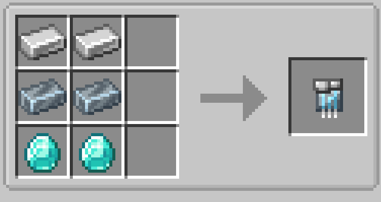

# Vibranium Circuit

{ width=100 height=100 loading=lazy }

Vibranium Circuits can be obtained via crafting with x2 Iron Ingots, x2 Vibranium Ingots, and x2 Diamonds in a crafting table:

{  loading=lazy }

Uses:

- Vibranium Circuits are used in crafting Advanced and Upgraded Web Shooters, the Model III and IV Arc Reactors, and the Nano-Housing Unit
