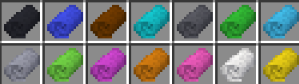
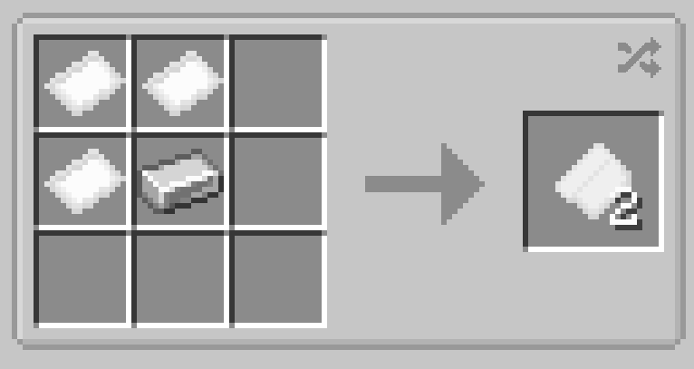

# Reinforced Fabric

{ width=415 height=116 loading=lazy }

**Reinforced Fabric** can be made via putting x3 [Basic Fabrics](basic-fabric.md) and x1 iron ingot into a crafting table; yielding x2 reinforced fabrics, with the color varying based on the color of basic fabric used.

{  loading=lazy }

Uses:

- Reinforced Fabric is used in many of the [Suitsets](../../../suitsets/index.md) in the addonpack
