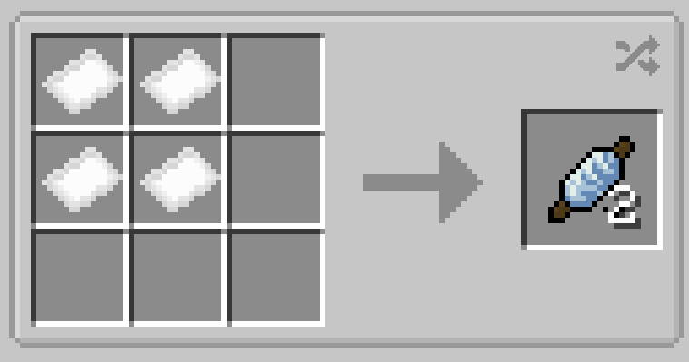

# Basic Fabric Repair Kit

{ width=100 height=100 loading=lazy }

Basic Fabric Repair Kits can be obtained via crafting with **any x**4 Basic Fabrics of the same color in a crafting table, yielding x2 Basic Fabric Repair Kits

{  loading=lazy }

Uses:

- Basic Fabric Repair Kits are used to repair Basic Fabric Based suits in an Anvil
