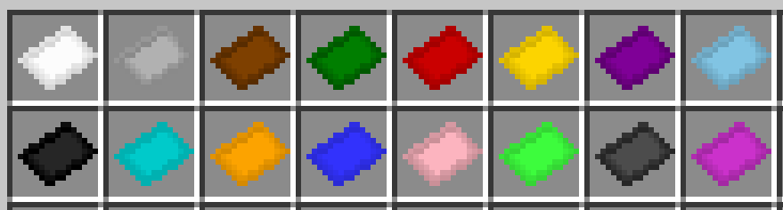
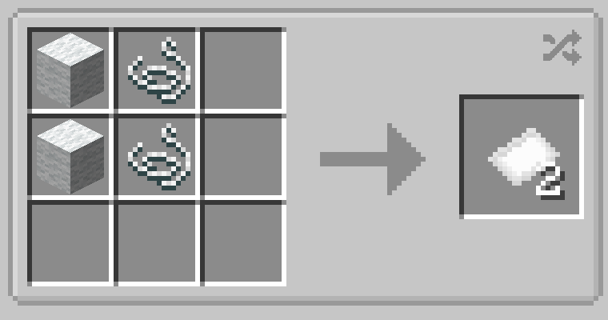

# Basic Fabric

{  loading=lazy }

Basic Fabric can be obtained via putting 2 wool and 2 string in a crafting table resulting in 2 basic fabric, **the color of the fabric varies depending on the color of the wool used.**

{  loading=lazy }

Uses:

- Basic Fabric is used in many of the [Suitsets](../../../suitsets/index.md) in the addonpack
