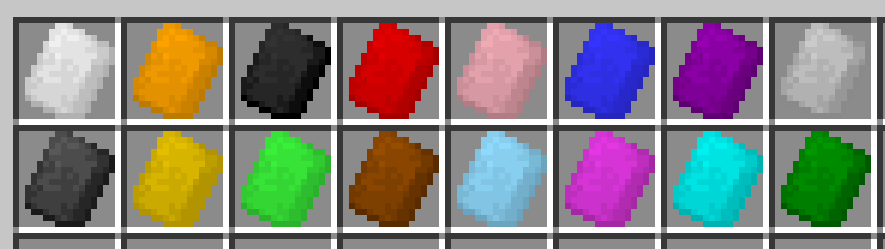
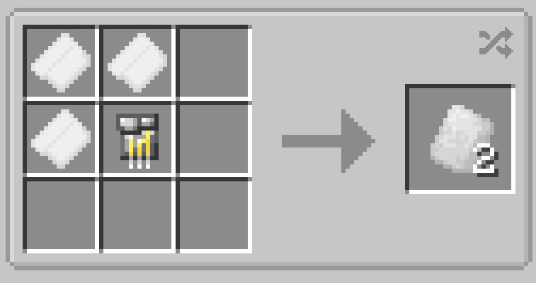

# Tri Polymer Fabric

{  loading=lazy }

**Tri-Polymer Fabric** can be obtained via putting x3 [Advanced Fabric](advanced-fabric.md) and x1 Iron Circuit in a crafting table; producing x2 Tri-Polmer fabric per, varying in color based on the color of Advanced Fabric used.

{  loading=lazy }

Uses:

- Tri-Polymer Fabric is used in many of the [Suitsets](../../../suitsets/index.md) in the addonpack.
