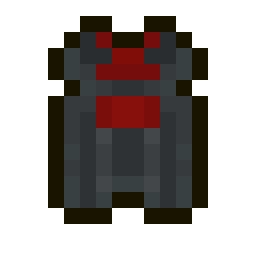
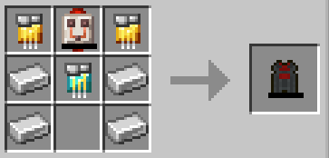
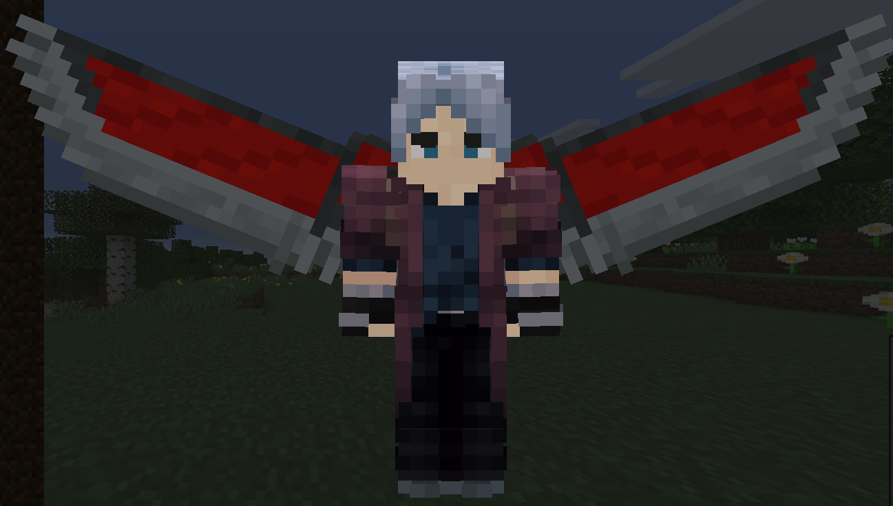
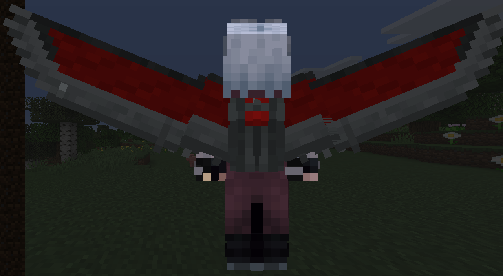

# Falcon Wings (Base)

{ width="135" height="135" loading=lazy }

The "**Falcon Wings (Base)"** can be obtained by crafting x4 Iron Ingot, x2 [Golden Circuit](../circuits/gold-circuit.md), x1 [Diamond Circuit](../circuits/diamond-circuit.md) and x1 Quartz Flux Capacitor.

{ width="373" height="179" loading=lazy }

Uses:

* Equip your Wings to the curios:back slot, and open them by using the Ability Slot 1. After opened them you can fly by pressing jump button twice.
* You can boost your flight with your second ability while in the air.
* Base Flight Speed: 0.5
* Boosted Flight Speed: 1

Related Information:

- For using the Falcon Wings you need to charge them with an [RF charger](../../../blocks/rf-charger.md) or any mod that charges RF.
- Max RF this item can hold is 25,000
- You can't use this item with any of the [Arc Reactors](../arc-reactors/index.md).

Falcon Wings(Base) when they are activated:

{ width="530" height="299" loading=lazy }

{ width="534" height="292" loading=lazy }
