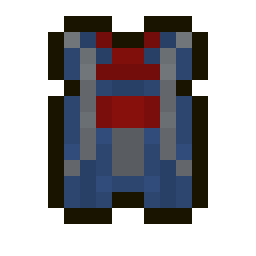
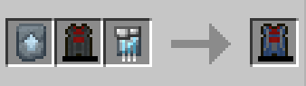
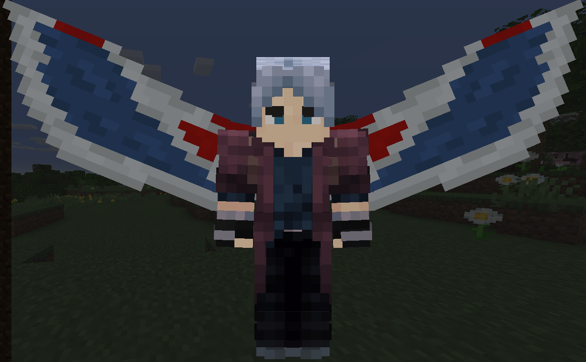
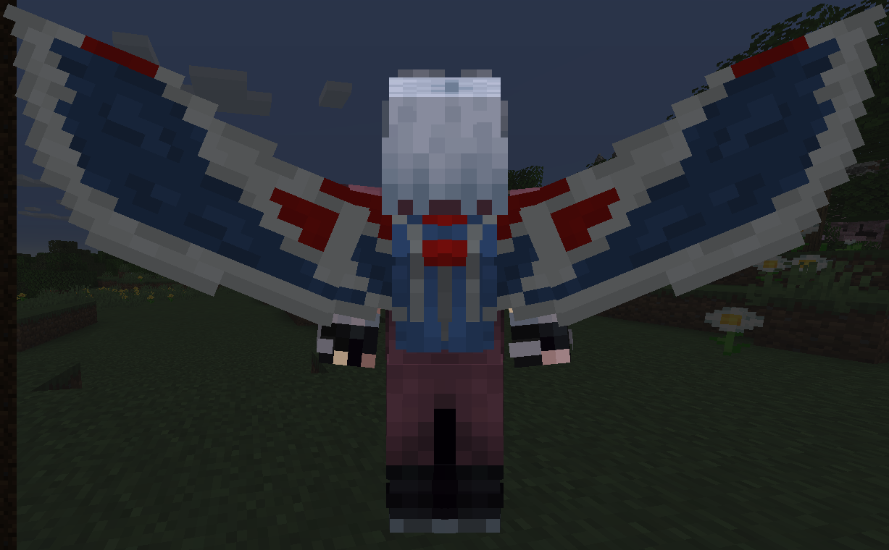

# Falcon Wings (Vibranium)

{ width="113" height="113" loading=lazy }

The **"Falcon Wings(Vibranium)"** can be obtained by crafting a [Falcon Wings(Base)](falcon-wings-base.md), [Vibranium Circuit](../circuits/vibranium-circuit.md) and a Vibranium Template inside a smithing table.

{ width="329" height="92" loading=lazy }

Uses:

* Equip your Wings to the **curios:back** slot, and activate them by using the Ability Slot 1. After activated them you can fly by pressing jump button twice.
* You can boost your flight with your second ability while in the air.
* You can dash with your second ability in the ground while your wings are closed.
* You can use your Vibranium Wings to block any incoming attack for a short period by crouch using your third ability.
* You can throw explosive Vibranium Feathers by using your third ability. For using this ability you need to insert Vibranium Feathers to your wings, use the third ability while holding the Vibranium Feathers in your mainhand for inserting them. Max Feather you can store is 128.
* Base Flight Speed: 0.8
* Boosted Flight Speed: 1.5

Related Information:

- For using the Falcon Wings you need to charge them with an [RF charger](../../../blocks/rf-charger.md) or any mod that charges RF.
- Using Boosted Flight will use more RF energy.
- Max RF this item can hold is 50,000
- You can't use this item with any of the [Arc Reactors](../arc-reactors/index.md).

Falcon Wings(Base) when they are activated:

{ width="497" height="307" loading=lazy }

{ width="499" height="308" loading=lazy }
