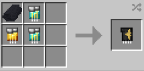

# Glide Module

{ width="100" height="100" loading=lazy }

**Glide Module** can be obtained via crafting with x2 Diamond Circuit, x1 Golden Circuit and x1 Black Tri-Polymer Fabric inside a crafting table.

{ width="315" height="155" loading=lazy }

**Uses:**

Righ-Click to Glide Module in Mainhand while equipped a cape for inserting glide module inside cape.

For activating glide crouch while in the air.
