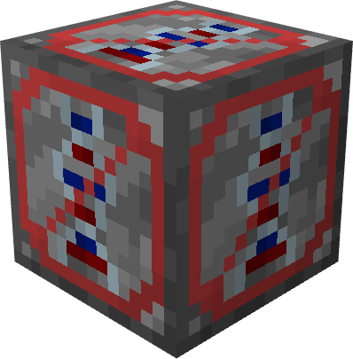
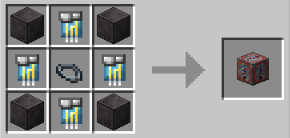

# Genetic

{ width="128" height="130" loading=lazy }

The "**Genetic Inhibitor Block"** is can be obtained via crafting with x1[ Base Inhibitor Collar](../inhibitor-collars/inhibitor-collar1-base.md), x4 Block of Netherite and x4 Genetic Inhibitor Circuit in a crafting table.

{ width=278 height=132 loading=lazy }

Uses:

Placing this block will dampen Genetic Powers in 5x5x5 radius. Genetic Powers that effected from this block are:

* [Mutants](../../../../powers/main-powers/mutations-x-gene/index.md)
* [Super Soldiers](../../../../powers/main-powers/super-soldiers/index.md)
* [Sand-Control](../../../../powers/main-powers/sand-infused-human.md)
* [Radioactive Blindness](../../../../powers/main-powers/radioactive-blindness.md)
* [Arachnids](../../../../powers/main-powers/arachnids/index.md)
* [Matter Absorbtion](../../../../powers/main-powers/matter-absorption.md)
* [Supes](../../../../powers/main-powers/supes/index.md)
* [Meta Humans](../../../../powers/main-powers/meta-humans/index.md)
* [Artificial Necrotech](../../../../powers/main-powers/artificial-necrotech.md)
* [Viltrumites](../../../../powers/main-powers/viltrumites/index.md)
* [Sentry](../../../../powers/main-powers/sentry/index.md)
* [Hulks](../../../../powers/main-powers/hulks/index.md)
* [Martians](../../../../powers/main-powers/martians/index.md)
* [Kree Hybrid](../../../../powers/main-powers/kree-hybrid.md)
* [Czarnian](../../../../powers/main-powers/czarnian.md)
* [Anti Matter](../../../../powers/main-powers/anti-matter.md)
