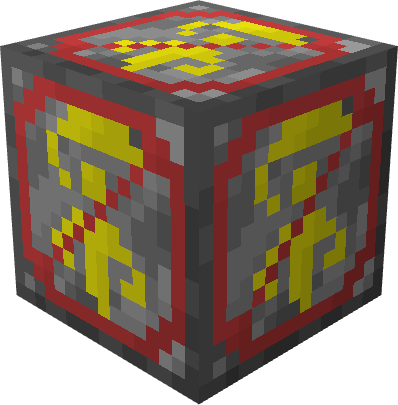
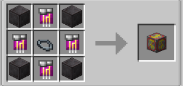

# Metaphysical

{ width="98" height="99" loading=lazy }

The "**Metaphysical Dampening Block"** is can be obtained via crafting with x1 [Base Inhibitor Collar](../inhibitor-collars/inhibitor-collar1-base.md), x4 Block of Netherite and x4 Metaphysical Inhibitor Circuit in a crafting table.

{ width=263 height=124 loading=lazy }

Uses:

Placing this block will dampen Metaphysical Powers in 5x5x5 radius. Metaphysical Powers that effected from this block are:

* [Radiants](../../../../powers/main-powers/radiants/index.md)
* [Asgardians](../../../../powers/main-powers/asgardians/index.md)
* [Hell Spawn](../../../../powers/main-powers/hell-spawn.md)
* [Cosmic Radiated Individuals](../../../../powers/main-powers/cosmic-radiated-individuals/index.md)
* [Shazam](../../../../powers/main-powers/shazam.md)
* [Amazons](../../../../powers/main-powers/amazon/index.md)
* [Atlanteans](../../../../powers/main-powers/atlanteans/index.md)
* [Cursed Users](../../../../powers/main-powers/cursed-users/boogie-woogie.md)
* [Void](../../../../powers/main-powers/sentry/void.md)
* [Symbiotes](../../../../powers/secondary-powers/symbiotes/index.md)
* [Kaiju](../../../../powers/secondary-powers/kaiju/index.md)
* [Phoenix Force](../../../../powers/secondary-powers/phoenix-force.md)
* [Cosmic](../../../../powers/secondary-powers/cosmic.md)
* [Spirit of Vengance](../../../../powers/secondary-powers/spirit-of-vengance.md)
