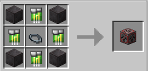

# Red Sun

{ width="102" height="103" loading=lazy }

The "**Red Sun Emitter Block"** is can be obtained via crafting with x1 [Base Inhibitor Collar](../inhibitor-collars/inhibitor-collar1-base.md), x4 Block of Netherite and x4 Red Sun Inhibitor Circuit in a crafting table.

{ width=266 height=129 loading=lazy }

Uses:

Placing this block will dampen any Solar based powers in 5x5x5 radius. Solar based powers that effected from this block are:

* [Kryptonians (Full)](../../../../powers/main-powers/kryptonians-full/index.md)
* [Kryptonians (Half)](../../../../powers/main-powers/kryptonians-half/index.md)
