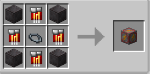

# Speed

{ width="101" height="102" loading=lazy }

The "**Speed Inhibitor Block"** is can be obtained via crafting with x1 [Base Inhibitor Collar](../inhibitor-collars/index.md), x4 Block of Netherite and x4 Speed Inhibitor Circuit in a crafting table.

{ width="302" height="150" loading=lazy }

Uses:

Placing this block will dampen Speed Powers in 5x5x5 radius. Speed Powers that effected from this block are:

* [Speedforce](../../../../powers/main-powers/speedforce/index.md)
