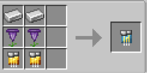

# Genetic

{ width="100" height="100" loading=lazy }

The "**Genetic Inhibitor Collar"** can be obtained via Right-Clicking a Genetic Inhibitor Circuit in offhand, [Base Inhibitor Collar](inhibitor-collar1-base.md) in mainhand. Genetic Inhibitor Circuit is obtained via crafting x2 Iron Ingot, x2 Golden Circuit and x2 Heart-Shaped Herb in a crafting table.

{ width="280" height="139" loading=lazy }

**Uses:**

You need to power the Collar by Crouch + Right-Clicking in your mainhand. Doing it again will turn it off.

Right-Click a target whose health is below 50% HP to equip it to them, this will result in the collar becoming bound to them, stopping them from using their powers.

You can remove this collar with one of the [Keys ](../keys/index.md)depending on the Security Level.

You can increase the security of the Collar with a [Inhibitor Module (Security)](../inhibitor-module-security.md).

Genetic Powers that can be dampened are:

* [Mutants](../../../../powers/main-powers/mutations-x-gene/index.md)
* [Super Soldiers](../../../../powers/main-powers/super-soldiers/index.md)
* [Sand-Control](../../../../powers/main-powers/sand-infused-human.md)
* [Radioactive Blindness](../../../../powers/main-powers/radioactive-blindness.md)
* [Arachnids](../../../../powers/main-powers/arachnids/index.md)
* [Matter Absorbtion](../../../../powers/main-powers/matter-absorption.md)
* [Supes](../../../../powers/main-powers/supes/index.md)
* [Meta Humans](../../../../powers/main-powers/meta-humans/index.md)
* [Artificial Necrotech](../../../../powers/main-powers/artificial-necrotech.md)
* [Viltrumites](../../../../powers/main-powers/viltrumites/index.md)
* [Sentry](../../../../powers/main-powers/sentry/index.md)
* [Hulks](../../../../powers/main-powers/hulks/index.md)
* [Martians](../../../../powers/main-powers/martians/index.md)
* [Kree Hybrid](../../../../powers/main-powers/kree-hybrid.md)
* [Czarnian](../../../../powers/main-powers/czarnian.md)
* [Anti Matter](../../../../powers/main-powers/anti-matter.md)
