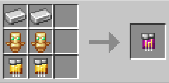

# Metaphysical

{ width="100" height="100" loading=lazy }

The "**Metaphysical Inhibitor Collar"** can be obtained via Right-Clicking a Metaphysical Inhibitor Circuit in offhand, [Base Inhibitor Collar](inhibitor-collar1-base.md) in mainhand. Metaphysical Inhibitor Circuit is obtained via crafting x2 Iron Ingot, x2 Golden Circuit and x2 Totem of Undying in a crafting table.

{ width="285" height="141" loading=lazy }

Uses:

You need to power the Collar by Crouch + Right-Clicking in your mainhand. Doing it again will turn it off.

Right-Click a target whose health is below 50% HP to equip it to them, this will result in the collar becoming bound to them, stopping them from using their powers.

You can remove this collar with one of the [Keys](../keys/index.md) depending on the Security Level.

You can increase the security of the Collar with a [Inhibitor Module (Security)](../inhibitor-module-security.md).

Metaphysical Powers that can be collared are:

* [Radiants](../../../../powers/main-powers/radiants/index.md)
* [Asgardians](../../../../powers/main-powers/asgardians/index.md)
* [Hell Spawn](../../../../powers/main-powers/hell-spawn.md)
* [Cosmic Radiated Individuals](../../../../powers/main-powers/cosmic-radiated-individuals/index.md)
* [Shazam](../../../../powers/main-powers/shazam.md)
* [Amazons](../../../../powers/main-powers/amazon/index.md)
* [Atlanteans](../../../../powers/main-powers/atlanteans/index.md)
* [Cursed Users](../../../../powers/main-powers/cursed-users/boogie-woogie.md)
* [Void](../../../../powers/main-powers/sentry/void.md)
* [Symbiotes](../../../../powers/secondary-powers/symbiotes/index.md)
* [Kaiju](../../../../powers/secondary-powers/kaiju/index.md)
* [Phoenix Force](../../../../powers/secondary-powers/phoenix-force.md)
* [Cosmic](../../../../powers/secondary-powers/cosmic.md)
* [Spirit of Vengance](../../../../powers/secondary-powers/spirit-of-vengance.md)
