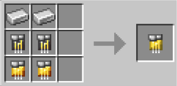

# Tech

{ width="100" height="100" loading=lazy }

The "**Tech Inhibitor Collar"** is can be obtained via Right-Clicking a Tech Inhibitor Circuit in offhand, [Base Inhibitor Collar](inhibitor-collar1-base.md) in mainhand. Tech Inhibitor Circuit is obtained via crafting x2 Iron Ingot, x2 Golden Circuit and x2 Netherite Circuit in a crafting table.

{ width="295" height="143" loading=lazy }

Uses:

You need to power the Collar by Crouch + Right-Clicking in your mainhand. Doing it again will turn it off.

Right-Click a target whose health is below 50% HP to equip it to them, this will result in the collar becoming bound to them, stopping them from using their powers.

You can remove this collar with one of the [Keys ](../keys/index.md)depending on the Security Level.

You can increase the security of the Collar with a [Inhibitor Module (Security)](../inhibitor-module-security.md).

Tech Based powers, items and suits that can be collared are:

* [Extremis](../../../../powers/main-powers/extremis.md)
* [Iron Man Suits](../../../../suitsets/iron-man-suits/index.md)
* [Arc Reactors](../../arc-reactors/index.md)
* [Scarabs](../../../../powers/secondary-powers/scarabs.md)
* [Batman Beyond](../../../../suitsets/armorsets/batman-beyond.md)
* [Falcon Wings](../../falcon-wings/index.md)
