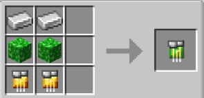

# Red Sun

{ width=100 height=100 loading=lazy }

The "**Red Sun Inhibitor Collar"** is can be obtained via Right-Clicking a Red Sun Inhibitor Circuit in offhand, [Base Inhibitor Collar](inhibitor-collar1-base.md) in mainhand. Red Sun Inhibitor Circuit is obtained via crafting x2 Iron Ingot, x2 Golden Circuit and x2 [Kryptonite ](../../../../blocks/ores/kryptonite.md)Block in a crafting table.

{ width=261 height=125 loading=lazy }

Uses:

You need to power the Collar by Crouch + Right-Clicking in your mainhand. Doing it again will turn it off.

Right-Click a target whose health is below 50% HP to equip it to them, this will result in the collar becoming bound to them, stopping them from using their powers.

You can remove this collar with one of the [Keys ](../keys/index.md)depending on the Security Level.

You can increase the security of the Collar with a [Inhibitor Module (Security)](../inhibitor-module-security.md).

Solar Based Powers that can be collared are:

* [Kryptonians (Full)](../../../../powers/main-powers/kryptonians-full/index.md)
* [Kryptonians (Half)](../../../../powers/main-powers/kryptonians-half/index.md)
