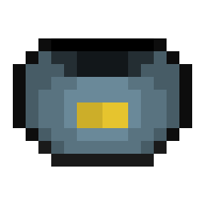
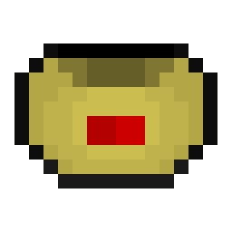
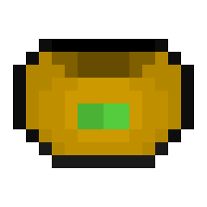
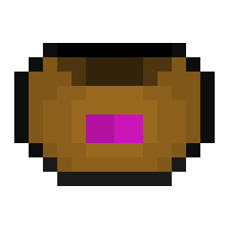

# Inhibitor Cuffs

{ width="68" height="68" loading=lazy }{ width="67" height="67" loading=lazy }{ width="66" height="66" loading=lazy }{ width="65" height="65" loading=lazy }{ width="67" height="67" loading=lazy }

Here you can find the information regarding the different Inhibitor Cuffs, how to use them, and how to remove them from yourself.

**Cuffs:**

* [Genetic](genetic-inhibitor-cuff.md)
* [Tech](tech-inhibitor-cuff.md)
* [Speed](speed-inhibitor-cuff.md)
* [Solar](solar-inhibitor-cuff.md)
* [Metaphysical](metaphysical-inhibitor-cuff.md)
