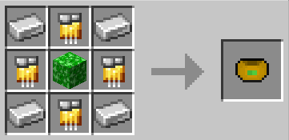

# Solar Inhibitor  Cuff

{ width="101" height="101" loading=lazy }

The "**Inhibitor Cuff (Solar)"** is can be obtained via crafting with x1 [Kryptonite ](../../../../blocks/ores/kryptonite.md)Block, x4 Iron Ingot and x4 [Golden Circuit ](../../circuits/gold-circuit.md)in a crafting table.

{ width="369" height="178" loading=lazy }

Uses:

Punching a Solar Based Powers with the cuff when they are at 25% or below HP will result in the cuff becoming bound to them, stopping them from using their powers, unless they escape by rapidly tapping the available key before the energy bar is full. Solar Based Powers that can be cuffed are:

* [Kryptonians (Full)](../../../../powers/main-powers/kryptonians-full/index.md)
* [Kryptonians (Half)](../../../../powers/main-powers/kryptonians-half/index.md)

Related Information:

- This Cuff can be removed by using the [Diamond Key.](../keys/diamond.md)
