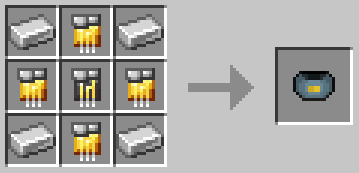

# Tech Inhibitor Cuff

{ width="110" height="110" loading=lazy }

The "**Inhibitor Cuff (Tech)"** is can be obtained via crafting with x1 [Netherite Circuit](../../circuits/netherite-circuit.md), x4 Iron Ingot and x4 [Golden Circuit ](../../circuits/gold-circuit.md)in a crafting table.

{ width="386" height="184" loading=lazy }

**Uses:**

Punching a person with the cuff when they are at 25% or below HP will result in the cuff becoming bound to them, stopping them from using their Tech based powers or any Tech items / suits, unless they escape by rapidly tapping the available key before the energy bar is full. Tech Based powers, items and suits that can be cuffed are:

- [Extremis](../../../../powers/main-powers/extremis.md)
- [Iron Man Suits](../../../../suitsets/iron-man-suits/index.md)
- [Arc Reactors](../../arc-reactors/index.md)
- [Scarabs](../../../../powers/secondary-powers/scarabs.md)
- [Batman Beyond](../../../../suitsets/armorsets/batman-beyond.md)
- [Falcon Wings](../../falcon-wings/index.md)

Related Information:

- This Cuff can be removed by using the [Diamond Key](../keys/diamond.md).
