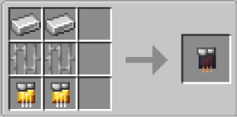

# Inhibitor Module (Security)

{ width="100" height="100" loading=lazy }

**Inhibitor Module (Security)** can be obtained via crafting with x2 Iron Ingot, x2 Iron Bars and x2 Golden Circuit inside a crafting table.

{ width="314" height="155" loading=lazy }

Uses:

Right-Click a filled [Inhibitor Collar](inhibitor-collars/index.md) in your mainhand,while holding Module in your offhand, to increase the tier key needed to be used to remove the Inhibitor Collar.
