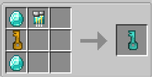

# Diamond Key

{ width=100 height=100 loading=lazy }

The **Diamond Key** can be obtained via crafting with x2 Diamonds, x1 [Golden Key](golden.md), and x1 [Diamond Circuit](../../circuits/diamond-circuit.md) in a crafting table.

{ width=302 height=153 loading=lazy }

Uses:

* This key can be used to unlock Tier 2[ Inhibitor Collars](../inhibitor-collars/index.md) and [Inhibitor Cuffs](../inhibitor-cuffs/index.md).
