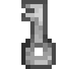
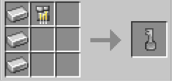

# Iron Key

{ width=100 height=100 loading=lazy }

The **Iron Key** can be obtained via crafting with x3 Irons, x1 Iron Circuit in a crafting table.

{ width=397 height=186 loading=lazy }

Uses:

* This key can be used to unlock Tier 1[ Inhibitor Collars](../inhibitor-collars/index.md).
