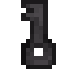
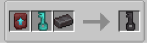

# Netherite Key

{ width=100 height=100 loading=lazy }

The **Netherite Key** can be obtained via crafting with x1 Netherite Smithing Template, x1[ Diamond Key](diamond.md), and x1 Netherite Ingot in a Smithing Table.

{ width=446 height=132 loading=lazy }

Uses:

* This key can be used to unlock Tier 4[ Inhibitor Collars](../inhibitor-collars/index.md).
