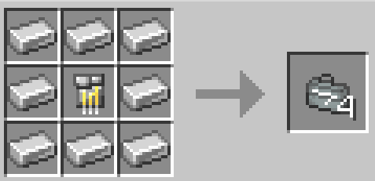

# Stark Repair Kit

{ width=113 height=113 loading=lazy }

The _Stark Repair Kit_ can be obtained via crafting with the use of Iron ingots and an [Iron circuit](../circuits/iron-circuit.md) as shown in the recipe below:

{ width="358" height="174" loading=lazy }

Uses:

* This can be used to repair any Iron man suit that uses the Template I suit in it's crafting recipe when placed in an anvil.
