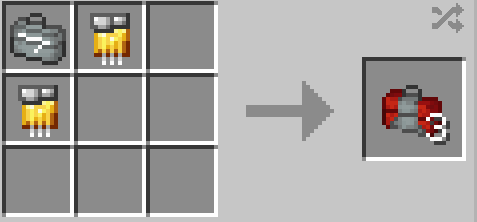

# Modular Stark Repair Kit

{ width=128 height=128 loading=lazy }

The _Modular Stark Repair Kit_ can be obtained via crafting with the use of [Stark Repair Kit](1-basic-stark-repair-kit.md) and x2 Golden circuits as shown in the recipe below:

{ width=358 height=167 loading=lazy }

Uses:

* This can be used to repair any Iron man suit that uses the Template II suit in it's crafting recipe when placed in an anvil.
