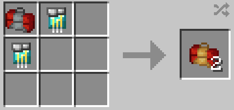

# Bleeding Edge Stark Repair Kit

{ width=138 height=138 loading=lazy }

The _Advanced Stark Repair Kit_ can be obtained via crafting with the use of [Modular Stark Repair Kit](2-enhanced-stark-repair-kit.md) and x2 [Diamond circuits](../circuits/diamond-circuit.md) as shown in the recipe below:

{ width=359 height=169 loading=lazy }

Uses:

* This can be used to repair any Iron man suit that uses the Template III suit in it's crafting recipe when placed in an anvil.

Related Information:

* Can be used to repair the following suits:
  * [Iron Man Model LXX](../../../suitsets/iron-man-suits/model-70.md)
  * [Iron Man Model NIL](../../../suitsets/iron-man-suits/model-nil.md)
