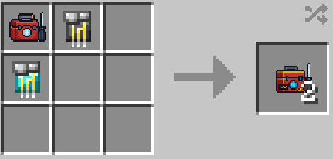

# Cutting-Edge Stark Repair Kit

{ width="123" height="123" loading=lazy }

The _Cutting-Edge Stark Repair Kit_ can be obtained via crafting with the use of [Advanced Stark Repair Kit](3-advanced-stark-repair-kit.md) x1 [Titanium circuit](../circuits/titanium-circuit.md) and x1 [Diamond circuit](../circuits/diamond-circuit.md) as shown in the recipe below:

{ width="353" height="169" loading=lazy }

Uses:

* This can be used to repair any Iron man suit that uses the Template IV suit in it's crafting recipe when placed in an anvil.

Related Information:

* Can be used to repair the following suits:
  * [Iron Man Model LXXI](../../../suitsets/iron-man-suits/model-71.md)
