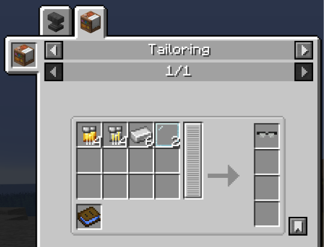

# StarkTech Glasses

{ width=100 height=100 loading=lazy }

**StarkTech Glasses** can be obtained via crafting with x4 Golden Circuit, x4 Iron Circuit, x6 Iron Ingot and x2 Glass Pane with a blueprint book inside a tailoring table.

{ width=404 height=309 loading=lazy }

**Uses:**

This glasses grant you the ability to use [AI Chips](../ai-chips.md) without needing an Iron Man Suit. Right-Click an AI Chip while glasses equipped in your Helmet slot, for removing the AI Chip Right-Click while glasses in your Offhand.

Equipping StarkTech Glasses will give you 3 Armor, 1 Toughness
