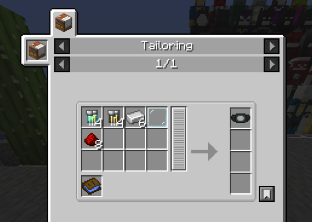

# StarkTech Watch

{ width=100 height=100 loading=lazy }

**StarkTech Watch** can be obtained via crafting with x4 Netherite Circuit, x4 Diamond Circuit, x6 Iron Ingot, x1 Glass Pane and x8 Redstone Dust with a blueprint book inside a tailoring table.

{ width=385 height=273 loading=lazy }

**Uses:**

This watch gives you ability to store your Iron Man(Non Nano Tech and Non Hulkbuster) type Suits inside it.

Equip this watch in curios:hands and crouch-right click while wearing an Iron Man(Non Nano Tech and Non Hulkbuster) type Suit to save in watch., then do the same to retrieve it.
