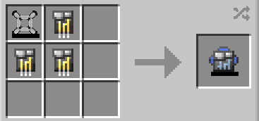

# Advanced Tachyon Device

{ width="113" height="113" loading=lazy }

The **_Advanced Tachyon Device_** can be obtained via crafting with x1 [Prototype Tachyon Device](prototype-tachyon-device.md) and x3 [Titanium Circuit](../circuits/titanium-circuit.md) inside a crafting table:

{ width="346" height="162" loading=lazy }

Uses:

- Wearing this device can increase your speed as a Speedster whenever you activate your speed.
- Equip your Tachyon device to the **curios:body** slot, and activate them by using the Ability Slot 1.
- Theres 10 Speed level. You can increase your speed by using your second ability non-crouched, and decrease it with crouch using the second ability.
  * Extra speed gained from each level are: 100% / 200% / 300% / 400% / 500% / 600% / 700% / 800% / 900% / 1000%

Related Information:

* For using the Tachyon Device you need to charge them with an [RF charger](../../../blocks/rf-charger.md) or any mod that charges RF.
* Using higher levels of speed will use more RF energy.
* Max RF this item can hold is 50,000.
* This device is small enough to be hidden when worn.
* This device can only be **useable by Speedsters**. Speedster that can use this device are:
  * [Speedforce Users](../../../powers/main-powers/speedforce/index.md)
  * [Speed Mutant](../../../powers/main-powers/mutations-x-gene/speed.md)
