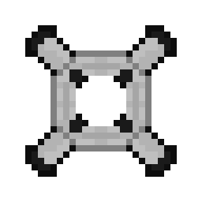
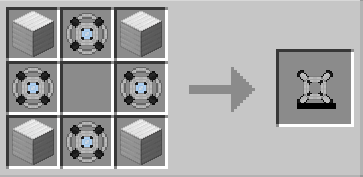

# Prototype Tachyon Device

{ width="121" height="121" loading=lazy }

The **_Prototype Tachyon Device_** can be obtained via crafting x4 Iron Blocks and x4 Tachyon Reactor inside a crafting table:

{ width="323" height="158" loading=lazy }

Uses:

- Equip your Tachyon device to the **curios:body** slot, and activate them by using the Ability Slot 1.
- Using this device will increase your speed significantly.
- Theres 10 Speed level. You can increase your speed by using your second ability non-crouched, and decrease it with crouch using the second ability.
  * Extra speed gained from each level: 100% / 200% / 300% / 400% / 500% / 600% / 700% / 800% / 900% / 1000%

Related Information:

* For using the Tachyon Device you need to charge them with an [RF charger](../../../blocks/rf-charger.md) or any mod that charges RF.
* Using higher levels of speed will use more RF energy.
* Max RF this item can hold is 50,000.
* This device will show on your chest and will give you a pale cyan lightning trail.
