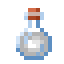
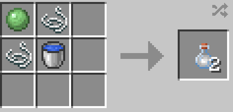

# Web Fluid

{  loading=lazy }

The _Web Fluid_ item can be obtained via combining 2x String, 1x Slime ball and 1x Water Bucket in a crafting grid as shown below in any order:

{ width="236" height="114" loading=lazy }

Uses:

* This item can be combined to create a [Web Cartridge](web-cartridge.md) which is needed to fill [Web Shooters](../gadgets/web-shooters/index.md).

Related Information:

* Upon crafting this item, you will receive 2 bottles of Web Fluid.
* Upon crafting this item, you will be returned an empty bucket.
