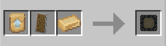

# Amazonian Shield

**Amazonian Shield** can be crafted with using 1 Nth Metal Template, 1 [Nth Metal](../../../blocks/ores/nth-metal.md) and 1 Vanilla Shield inside a smithing table.

This shield can be used to block any incoming attack, and has no durability.

{ width=289 height=82 loading=lazy }
