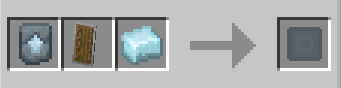
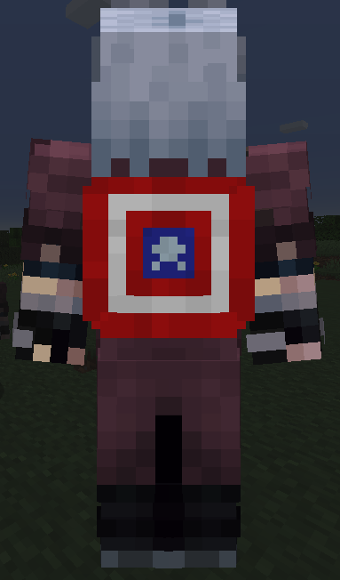
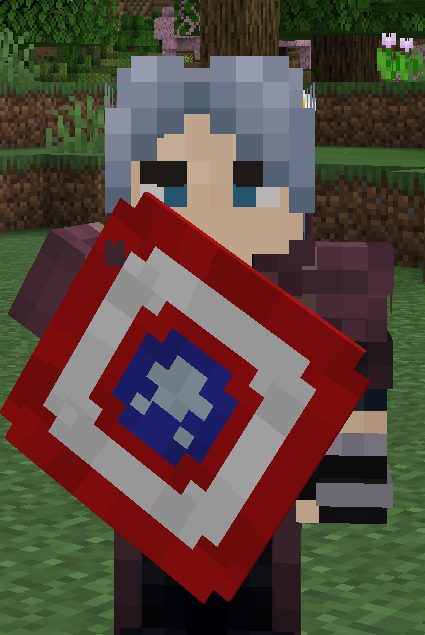
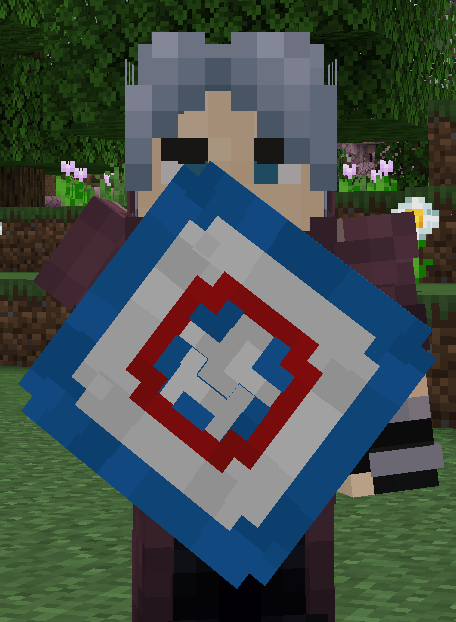
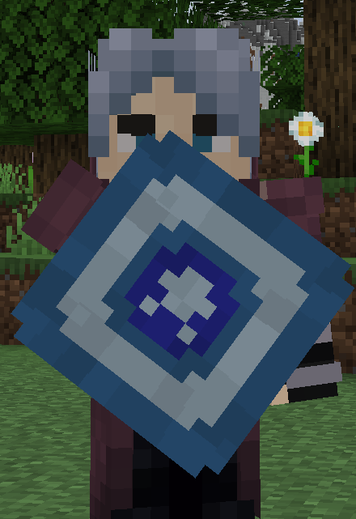
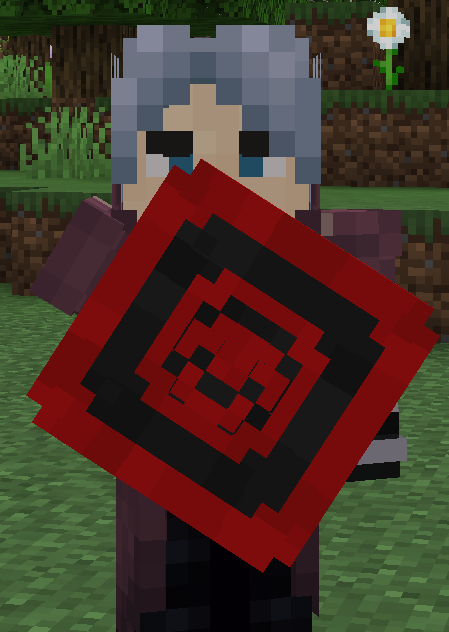

# Vibranium Shield

**Vibranium Shield** can be crafted with using 1 Vibranium Template, 1 [Adamantium](../../../blocks/ores/adamantium.md) and 1 Vanilla Shield inside a smithing table.

This shield can be used to block any incoming attack, and has no durability.

{ width=357 height=91 loading=lazy }

**Related Information:**

* This shield can be place in to the curious:back slot for displaying at your back.

  { width=142 height=242 loading=lazy }
* This shield has different cosmetic variants. Other variants only change to appareance of the shield. Current shield variants are:
  * Captain America - Steve 

    { width=185 height=276 loading=lazy }
  * Captain America - Sam 

    { width=185 height=252 loading=lazy }
  * Stealth 

    { width=186 height=271 loading=lazy }
  * Hydra 

    { width=189 height=266 loading=lazy }
