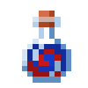
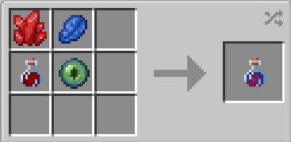

# X-Gene

{ width="100" height="100" loading=lazy }

The **"X-Gene"** can be obtained by using 1x [Ruby Quartz](material/ruby-quartz.md), 1x Lapis Lazuli, 1x [Augmented Human DNA](material/augmented-human-dna.md) and 1x Eye of Ender in a crafting table:

{ width="276" height="135" loading=lazy }

Uses:

* Consuming this item will grant you one of the [Mutant ](../powers/main-powers/mutations-x-gene/index.md)power.
* Can be used to craft other powers.

Related Information:

* Getting which [Mutant Power ](../powers/main-powers/mutations-x-gene/index.md)after consuming this is random chance. Lower tier has higher chances, and higher tier has lower chances.
