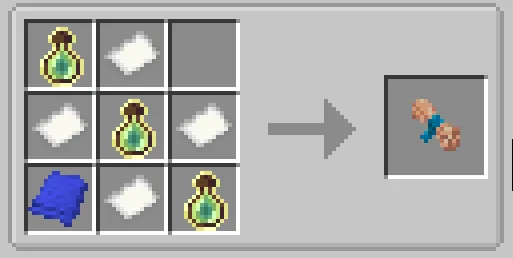
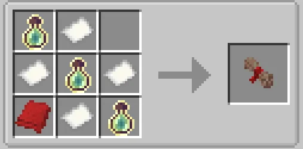
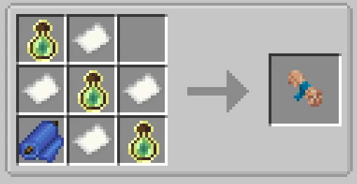
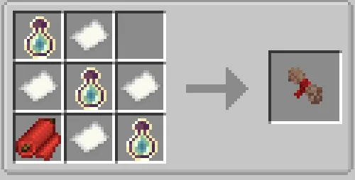
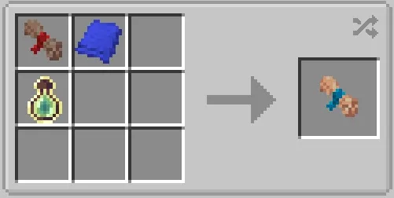
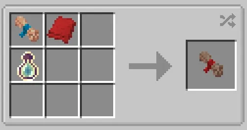

# Combat Techniques

**"Combat Techniques"** is a term used to describe powers obtainable that cannot be stacked with each other, but can be used in tandem with the [Main](../main-powers/index.md) and [Secondary ](../secondary-powers/index.md)Powers. Combat Techniques can be upgraded via their own Skill Point system. For getting acces to the Combat Techniques you need a **Knowledge Scroll(Combat)**.

**Knowledge scroll(Combat)** is an item used to access the combat system. Obtained by crafting it with an Basic Fabric(Blue), 3x Bottle o' Enchanting and 4x Paper.

{ width="496" height="249" loading=lazy }

* After using it, you need to go to the abilities menu and choose the fighting style you prefer, options being:
  * [Combat Specialist Stealth](combat-specialist-stealth.md)
  * [Combat Specialist Brute](combat-specialist-brute.md)
  * [Combat Specialist Martial Artist](combat-specialist-martial-artist.md)
* To progress in your combat styles you need to activate your combat mode with \[Ability 1\] keybind and attack(Left-click/Right-click) aggresive mobs or players, with each hit giving varying xp per hit 1-3. Upon reaching 500 xp you will get your Combat Skill Point respective to your style.
* You can remove your current Combat Style and equip new one with a new scroll, but your progression on your previous style will be forgotten. Your unused Combat Style Points will remain when you forget your previous Combat Style.
* **To** **remove your combat style**, you need to craft **Doctrine of Stillness(Combat)** with Basic Fabric(Red) 3x Bottle o' Enchanting and 4x Paper.

  { width="461" height="227" loading=lazy }
  * You can use both this add-on Basic Fabric(Blue/Red) and Palladium colored Fabrics.

    { width="257" height="132" loading=lazy }{ width="262" height="132" loading=lazy }
  * Alternatively, you can use both scrolls for crafting their opposite version with a singular piece of fabric and bottle o' enchanting.

    { width="262" height="131" loading=lazy }{ width="251" height="131" loading=lazy }
* Although all of the Combat Styles can be used by themself, they are meant to be used with either Main and Secondary powers, and they all compatible with every single one of them. 
* You cannot have two Combat Styles at the same time.
