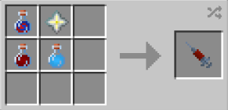

# Anti Matter

{ width="100" height="100" loading=lazy }

The "**Anti-Matter"** is obtained by using Anti-Matter DNA. This can be crafted by crafting it with an [X-Gene](../../items/x-gene.md), a Nether Star, an [Augmented Human D.N.A Sample](../../items/material/augmented-human-dna.md) and a [Super Soldier Serum](../../items/super-soldier-serum.md) inside a crafting table.

{ width="251" height="121" loading=lazy }

**Stats**

* Maximum Health: 36
* Maximun Healing / Second: 2 HP / 3.5 Seconds
* Armor Rating: 12
* Armor Toughness: 4
* Base Attack Damage: 16
* Sprint Speed: 300%
* Flight Speed: 1.98

**Main Abilities**:

* **Slot 1 (Crouch): "Combat Abilities"** - Open the ability wheel to change what active ability you have for your first slot. Selected abilities are used with non-crouch. The Abilities for the first slots are:
  * **"Strength-Based Grab"** - Use your strength pick up an entity and hold them in front of you.
  * **"Telekinesis" -** Use your stored energy to lift entities or blocks in front of you. Scroll up or down to change how far away the target is from you.
  * **"Energy Infused Hands" -** Passively drain the energy you've stored to dual wield and enhance your damage and knockback when both your hands are empty.
  * **"Matter Conversion" -** Change the form of iron/gold/diamond into various tools.
* **Slot 2 (Crouch): "Anti-Matter Manipulation"** - Open the ability wheel to change what active ability you have for your second slot. Selected abilities are used with non-crouch. The Abilities for the second slots are:
  * **"Anti-Matter Blast" -** Fire off a blast of raw Anti-Matter which can deal initial damage as well as decay overtime to targets hit. This ability can also destroy blocks on hit.
  * **"Anti-Matter Beam"** - Condense your Anti-Matter energy into a more refined, non-destructive, form as a beam. Entities hit by this beam will gain the **decay** effect.
  * **"Anti-Matter Shield" -** Use your Anti-Matter energy to create a shield in front of you to block incoming damage. Entities that come into contact with this shield will gain the decay effect.
* **Slot 3 (Non-Crouch): "Graviton Manipulation" -** Manipulate the gravitons around you to either increase or decrease the gravity in entities in a 5x5x5 radius around you while draining your energy. When holding this ability key, scroll up to increase gravity, down to decrease gravity and release it to stop affecting gravity.
* **Slot 4 (Non-Crouch): "Anti-Matter Annihilation Mode" -** For 30 seconds, surround yourself with Anti-Matter particles causing anyone who gets to close will gain the decay effect as well as increase your toughness and damage output by +10. This mode will heavily drain your energy.

**Related Information**:

* You can decrease / increase your Sprint Speed and Flight Speed with the correct keybinds. Default settings are Down Arrow / Up Arrow. Crouch using will get your percentage to maximum or minimum.
* The Anti-Matter power's abilities all use energy, which is displayed next to your powers as a blue bar and drained by using various abilities. This bar will passively refill overtime.
* This power has following _passives_;
  * **Fall Damage Immunity**
  * **Arrow Immunity**
  * **TACZ Bullet Immunity Compatibility**
* This power **cannot** use any [Secondary Powers](../secondary-powers/index.md).
* This power **cannot** use any [Arc Reactor](../../items/technology/arc-reactors/index.md) higher than the [Model I Reactor.](../../items/technology/arc-reactors/model-i.md)
* This power is _loosely_ based off of [Adam Brashear, a.k.a Blue Marvel](https://marvel.fandom.com/wiki/Adam_Brashear_\(Earth-616\)).
