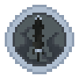
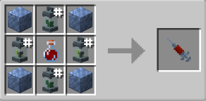

# Artificial Necrotech

{ width="100" height="100" loading=lazy }

The **"Artificial Necrotech"** is obtained via crafting x1 [Augmented Human D.N.A Sample](../../items/material/augmented-human-dna.md), x4 [Techno-Organic Metal Blocks](../../blocks/ores/techno-organic-ingot.md), x2 [Natural Symbiote](../secondary-powers/symbiotes/natural.md), x2 [Artificial Symbiote](../secondary-powers/symbiotes/artificial.md) inside a crafting table.

{ width=271 height=133 loading=lazy }

**Stats:**

* Maximum Health: 28
* Maximum Healing / Second: N / A
* Armor Rating: 18
* Armor Toughness: N / A
* Base Attack Damage: 6
* Sprint Speed: 110%
* Flight Speed: 0.25 (0.75 when boosters on)

**Main Abilities:**

* **Slot 1 (Non-Crouch): "Suit Up"** - This allows you to enable the Necrotech armor.
* **Slot 1 (While transformed):** "Summon Necrotech Tools" - This ability allows you to summon Necrotech tools. This ability has more purchase options which allows you summon tools following order Blade, Pickaxe, Axe, Shovel and Shield.
* **Slot 2 (Non-Crouch): "Necrotech Spikes"** - Fire off a spike of Necrotech that inflicts Blindness 2 and Wither 2 to the target hit.
* **Slot 2 (Crouch): "Necrotech Tendrils"** - Explode with a flurry of Necrotech Tendrils all around your body, damage everything in a 5x5x5 radius.
* **Slot 3 (Non-Crouch): "Necrotech Energy Beams "** - Fire of a blast of energy created by your Necrotech.
* **Slot 4 (While flying): "Necrotech Boosters"** - Using your Necrotech, form boosters around your legs to increase your speed while flying
* **Slot 4 (While not flying): "Necrotech Breaker Mode"** - Using your Necrotech, grow into your Breaker mode which enchances your stats while activated at the cost of your abilites and flight for up to 60 seconds, but will grant weakness for 10 seconds and wither for 5 seconds when disabled.

**Related Information:**

* You can't wear any armor while in Necrotech form.
* While in Breaker Mode you will gain +14 armor, +6 toughness and +10 damage.
