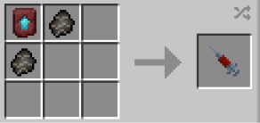

# Czarnian

{ width="100" height="100" loading=lazy }

The **"Czarnian"** is obtained via using Czarnian DNA. This can be crafted by crafting it with x2 [Czarnian Fossil](../../items/artifacts/fossils/czarnian.md) and a Smithing Template inside a crafting table.

{ width="293" height="139" loading=lazy }

**Stats:**

* Maximum Health: 46
* Maximum Healing / Second: 1 Heart / Second
* Armor Rating: 10
* Armor Toughness: 6
* Attack Damage: 16
* Sprint Speed: 130%

Main Abilities:

* **Slot 1 (Non-Crouch): "Block"** - Block all incoming damage for a max of 5 seconds (full recharge is the same)
* **Slot 1 (Crouch): "Block Break"** - This ability breaks a targeted block when held down for 5 / 3 / 1 seconds depending on the number of upgrades
* **Slot 2 (Non-Crouch + Crouch): "Target Grapple/Throw"** - Grab an entity for up to 10 seconds (full recharge is the same), launching them in the direction you are looking if you press crouch while in use
* **Slot 3 (Non-Crouch): "Striking Punch"** - Strike with a hard punch, dealing +9 on to your normal punch damage for a max of 25 (Your hand must be empty)
* **Slot 3 (Crouch): "Super Ground Stomp"** - Smash the ground using your super strength, exploding a large area beneath you

Related Information:

* This power **cannot** use any [Secondary Powers](../secondary-powers/index.md).
* This power **cannot** use any [Arc Reactor](../../items/technology/arc-reactors/index.md) higher than the [Model I Reactor](../../items/technology/arc-reactors/model-i.md).
* This power has the following _passives_;
  * **Night Vision**
  * **Fall Damage Immunity**
  * **Fire Damage Immunity**
  * **Lava Damage Immunity**
  * **Arrow Immunity**
  * **TACZ Bullet Immunity Compatibility**
* Upon unlocking the last upgrade in the regen tree, gain a passive replenishment of hunger when your bar drops below 7, never hitting 0 (this replenishes most of the food and saturation bar).
* This power is _loosely_ based off of [Lobo](https://dc.fandom.com/wiki/Lobo_\(New_Earth\)).
