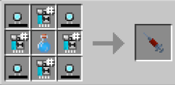

# Extremis

{ width="100" height="100" loading=lazy }

The "**Extremis"** is obtained via crafting x4 [Arc Reactor Cores](../../items/technology/arc-reactors/core.md), x4 of any [AI Chips](../../items/technology/ai-chips.md), and a [Super Soldier Serum](../../items/super-soldier-serum.md) inside a crafting table. This power focuses on providing buffs to wearing Stark Tech armors.

{ width=298 height=146 loading=lazy }

**Stats**:

* Maximum Health: 26
* Maximum Healing / Second: 2 HP / 3.5 Seconds
* Armor Rating: 8
* Armor Toughness: N / A
* Base Attack Damage: 7
* Sprint Speed: 130%
* Flight Speed: N / A

**in Abilities**:

* **Slot 1 (Non-Crouch,Not Transformed):** **"Enable Undersheath" -** Call forth the nanites within the hollows of your bones to form a skin tight armor layer that gives you access to the rest of your Extremis Abilities.
  * Crouch use for retracting the nanites of your undersheath armor.
* **Slot 1 (Non-Crouch,Transformed):** **"Wireless Connection"** - Emit a wireless redstone signal from up to 10 blocks away in the direction you are looking. If used on an entity, it will give them 1 second of Tech Dampening.
* **Slot 2 (Non-Crouch): "Revitalization Drive" -** Use up 2 saturation points in order to slightly heal yourself and repair the armor you are wearing. This repair effect is strengthened when wearing Stark Tech Armor. 
* **Slot 3 (Non-Crouch):** **"Nanite Armory"** - Link to one worn set of (non-nanotech and non-hulkbuster) based Stark Tech armor and store it within your nanites to be able to resummon it at will.

**Related Information**:

* This power has 3 different visual appearences when active which can be selected via the Accessory menu.
* You can decrease / increase your Sprint Speed with the correct keybinds. Default settings are Down Arrow / Up Arrow. Crouch using will get your percentage to maximum or minimum.
* This power has the following _passive_ abilities that can be unlockable:
  * **Arc Reactor’s Last Spark** - If you are wearing an arc reactor that is below 100RF, passively give it +100RF, allowing it to self sustain. You must have at least 3 saturation points for this to trigger.
  * **Arc Reactor’s Battery** - If you are wearing an Arc Reactor, you will generate an extra +20RF/second as long as you have more than 10 saturation points.
  * **Iron Legion Integration** - When wearing any set of regular Iron Man armor, gain an increase to your health, armor, toughness, and strength.
  * **Hulkbuster Integration** - When wearing any set of Hulkbuster armor, gain an increase to your health, armor, toughness, and strength.
* This power is based off of [Extremis Virus](https://marvel.fandom.com/wiki/Extremis_\(Virus\)).
