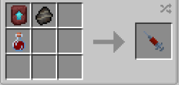

# Kree Hybrid

{ width="90" height="90" loading=lazy }

The **"Kree Hybrid"** is obtained via using a Kree Hybrid DNA. This can be crafted by crafting it with an [Kree Fossil](../../items/artifacts/fossils/kree-fossil.md), Smithing Template and a [Augmented Human DNA](../../items/material/augmented-human-dna.md) inside a crafting table. 

{ width=274 height=130 loading=lazy }

**Stats**:

* Maximum Health: 56
* Maximum Healing/Second: 2 HP / 3 seconds
* Armor Rating: 14
* Armor Toughness: 6
* Base Attack Damage: 13
* Sprint Speed: 725%
* Flight Speed: 2.25

**Main Abilities**:

* **Slot 1 (Crouch): "Combat Abilities"** - Open the ability wheel to change what active ability you have for your first slot. Selected abilities are used with non-crouch. The Abilities for the first slots are:
  * **"Strength-based Grab"** - With an empty main / offhand, use your strength to pick up an entity and hold them in front of you.
  * **"Block"** - Block incoming damage for a short while.
  * **"Photon Infused/Radiated Fists"** - With an empty main/offhand, harness your stored energy into your hands, slowly draining your energy, but increasing your punch damage. Your damage increase you gain is dependent on the amount of energy you have. In Binary form, rather than increasing your physical damage, this will grant Wither II to any target you hit.
* **Slot 2 (Non-Crouch): "Photon Based/Radiated Energy"** - Harness your stored energy into a beam of energy from your hand(s). Scroll while it is enabled to change the output which will increase the energy drain. In Binary Form, you will only have 1 output which is slightly weaker, but it will also apply Wither I to the target hit.
* **Slot 3 (Non-Crouch): "Photon Energy Explosion"** - Release a large amount of your stored energy to detonate a photon-based explosion at your location. While in Binary form, your explosion will hit in a wider radius and will give wither to all targets within that radius.

**Related Information:**

* This power **cannot** use any [Secondary Powers](../secondary-powers/index.md).
* This power **cannot** use any [Arc Reactor](../../items/technology/arc-reactors/index.md) higher than the [Model I Reactor](../../items/technology/arc-reactors/model-i.md).
* This power can breath in space using the Ad Astra Mod
* This power has the following _passives_;
  * **Fall Damage Immunity**
  * **Fire Damage Immunity**
  * **Lava Damage Immunity**
  * **Explosion Damage Immunity**
  * **Arrow Immunity**
  * **TACZ Bullet Immunity Compatibility**
* This power has an energy bar with a max of **100,000.**
  * **This bar will slowly passively charge up to 80,000.** Past that you will need to use the following methods:
    * This energy bar is passively filled up when you **take damage** and will constantly increase your armor stat the higher this value is. Using your abilities drains this stored energy.
    * As your armor stat increases with the addition of more stored energy, the harder it will be to store energy as the amount of energy added to your storage is determined by the amount of damage taken.
* This power will have passively golden glowing eyes when flying.
* When in Binary Form, your character gets a red tint througout their body
* By unlocking the "**Photon Overcharge: Binary**" ability, whenever your energy levels reach 75k, passively transform into your Binary form, gaining an increase to your attack based on the amount energy you have, an altered moveset, and the ability to see the energies of all entities within 20 blocks of you. If your energy levels fall below 75k, you will revert back to normal.
  * You will gain a default +4 to your attack damage, as well as as addition +3 if your energy reached 80,000 or higher, and an additional +7 when you reach 100,000 energy stored.
* This power is _loosely_ based off of [Carol Danvers, a.k.a Captain Marvel](https://marvel.fandom.com/wiki/Carol_Danvers_\(Earth-616\)).
