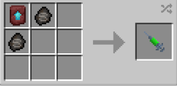

# Adventures

{ width="100" height="100" loading=lazy }

The **"Kryptonian - Adventures"** is obtained via using Kryptonian (Adventures) DNA. This can be crafted by crafting it with x2 [Kryptonian Fossil](../../../items/artifacts/fossils/kryptonian-fossil.md) and a Smithing Template inside a crafting table.

{ width="258" height="126" loading=lazy }

**Stats**:

* Maximum Health: 56
* Maximum Healing / Second: 2 HP / 2 Seconds
* Armor Rating: 12
* Armor Toughness: 8
* Base Attack Damage: 15
* Sprint Speed: 850%
* Flight Speed: 2

**Main Abilities**:

* **Slot 1 (Crouch): "Combat Abilities"** - Open the ability wheel to change what active ability you have for your first slot. Selected abilities are used with non-crouch. The Abilities for the first slots are:
  * **"Strength-based Grab"** - With an empty main / offhand, use your strength to pick up an entity and hold them in front of you.
  * **"Super Ground Punch"** - Using your strength punch the ground below you ca non-destructive explosion on the ground at your feet. This will knock entities away and deal AOE damage base on how close they are to you
  * **"Super Air punch"** - Using your strength to punch through the air, with an empty mainhand, creating a powerful impact that can destroy blocks. This ability scales with your strength
* **Slot 2 (Crouch): "Ranged Abilities"** - Open the ability wheel to change what active ability you have for your second slot. Selected abilities are used with non-crouch. The Abilities for the second slots are:
  * **"Kryptonian Frost Breath"** - Freeze the air you blow out of your mouth. Second Output can freeze blocks, Third output can freeze blocks and targets. While active, you can scroll to change the output. Higher output will drain solar energy more than lower outputs.
  * **"Kryptonian X-ray vision"** - Gain the ability to see entities within a 60 block radius. Scrolling while active can allow you to change between being able to see All, Players, Passive, Hostile entities. You will also gain the passive ability of Night Vision when you are below light level 10.
  * **"Kryptonian Heat vision"** - Fire off heated beams from your eyes to deal fire damage to your target. Second output can ignite certain blocks and fuel furnace-tyoe blocks, third output will also create fires where it hits. The higher the output, the more solar energy it will cost
* **Slot 3 (Non-Crouch): "Bioelectric Manipulation"** - Open the ability wheel to use your abilities in your third slot. You need to hover over the abilities and click them for using it. The Abilities for the third slots are:
  * **"Kryptonian Bioelectric Aura"** - Consume your solar energy to increase your base armor toughness by +12, Knockback resistance 100%, and attack knockback +5 for as long as it is active, at the cost of heavy solar drain.
  * **"Kryptonian Bioelectric Shield"** - Consume your solar energy to create a shield of bioelectric energy in front of you to protect those who are behind it.
  * **"Kryptonian Bioelectric Wave"** - Consume your solar energy to explode your bioelectric energy outward, shocking and dampening all tech in a 10x10x10 energy around you (including your own tech)

**Related Information**:

* This power **cannot** use any [Secondary Powers](../../secondary-powers/index.md).
* This power **cannot** use any [Arc Reactor](../../../items/technology/arc-reactors/index.md) higher than the [Model I Reactor](../../../items/technology/arc-reactors/model-i.md).
* This power has the following _passives_;
  * **Fall Damage Immunity**
  * **Fire Damage Immunity**
  * **Lava Damage Immunity**
  * **Explosion Damage Immunity**
  * **Projectile Immunity**
  * **TACZ Bullet Immunity Compatibility**
* Max Solar Energy: **900,000**
* Coming into proximity with any Kryptonite tools / blocks or items can cause the user to rapidly have their solar energy drained. All outputs (Heat vision and Freeze Breath) are reset to 1 and gain slowness. While in kryptonite poisoning you will **lose** all of your **armor, toughness and attack damage** bonus from this power. You cant use your powers in your 3rd ability wheel while you are effected. If the user is out of solar energy, and they still have the Kryptonite Poisoning effect, they will begin the lose hunger rapidly until the effect wears off.
* When on the ground and crouching, the scroll wheel can be used to increase / decrease the movement speed percentage. When in the air the scroll wheel can be used to increase / decrease the flight speed percentage.
* This power can gain solar energy faster by flying up to the Y level 500.
* This power gains various stats based on the amount of Solar energy stored up. (Stats additions below are based on **full solar energy**):
  * **Attack Damage**: +18
  * **Armor Rating**: +18
* This power is _loosely_ based off of [Kal-El, a.k.a Superman from My Adventures with Superman Show](https://myadventureswithsuperman.fandom.com/wiki/Superman).
