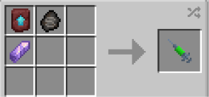

# CW

{ width="100" height="100" loading=lazy }

The **"Kryptonian - CW"** is obtained via using Kryptonian (CW) DNA. This can be crafted by crafting it with an [Kryptonian Fossil](../../../items/artifacts/fossils/kryptonian-fossil.md), Amethyst Shard and a Smithing Template inside a crafting table.

{ width=276 height=128 loading=lazy }

**Stats**:

* Maximum Health: 66
* Maximum Healing / Second: 2 HP / 2 Seconds
* Armor Rating: 12
* Armor Toughness: 6
* Base Attack Damage: 11
* Sprint Speed: 1050%
* Flight Speed: 2.5

**Main Abilities**:

* **Slot 1 (Crouch): "Combat Abilities"** - Open the ability wheel to change what active ability you have for your first slot. Selected abilities are used with non-crouch. The Abilities for the first slots are:
  * **"Strength-Based Grab"** - With an empty main / offhand, use your strength to pick up an entity and hold them in front of you.
  * **"Super Sonic Clap"** - Using your strength clap your hands together to send out a shockwave that can knockback and give the sound poisoning effect to ay target it comes in contact with
  * **"Rapid Super Punch"** - Rapidly punch your target with both hands. This ability scales with your strength output.
* **Slot 2 (Crouch): "Ranged Abilities"** - Open the ability wheel to change what active ability you have for your second slot. Selected abilities are used with non-crouch. The Abilities for the second slots are:
  * **"Kryptonian Frost Breath" -** Freeze the air you blow out of your mouth. Second Output can freeze blocks, Third output can freeze blocks and targets. While active, you can scroll to change the output. Higher output will drain solar energy more than lower outputs.
  * **"Kryptonian X-ray vision"** - Gain the ability to see entities within a 60 block radius. Scrolling while active can allow you to change between being able to see All, Players, Passive, Hostile entities. You will also gain the passive ability of Night Vision when you are below light level 10.
  * **"Kryptonian Heat vision"** - Fire off heated beams from your eyes to deal fire damage to your target. Second output can ignite certain blocks and fuel furnace-tyoe blocks, third output will also create fires where it hits. The higher the output, the more solar energy it will cost
* **Slot 3 (Non-Crouch): "Kryptonian Photonucleic Mode"** - Consume your solar energy to increase your base Attack Damage, Knockback Resistance, Attack Knockback, Healing and movement / flight speed for as long as it is active, at the cost of a heavy solar drain. You also can't contract Kryptonite Poisoning while this ability is enabled.

**Related Information**:

* This power **cannot** use any [Secondary Powers](../../secondary-powers/index.md).
* This power **cannot** use any [Arc Reactor](../../../items/technology/arc-reactors/index.md) higher than the [Model I Reactor](../../../items/technology/arc-reactors/model-i.md)..
* This power **can** breath in space using the **Ad Astra Mod.**
* This power has the following _passives_;
  * **Fall Damage Immunity**
  * **Fire Damage Immunity**
  * **Lava Damage Immunity**
  * **Explosion Damage Immunity**
  * **Projectile Immunity**
  * **TACZ Bullet Immunity Compatibility**
* Max Solar Energy: **700,000**
* Coming into proximity with any Kryptonite tools / blocks or items can cause the user to rapidly have their solar energy drained. All outputs (Heat vision and Freeze Breath) are reset to 1 and gain slowness. While in kryptonite poisoning you will **lose** all of your **armor, toughness and attack damage** bonus from this power. You cant use your powers in your 3rd ability wheel while you are effected. If the user is out of solar energy, and they still have the Kryptonite Poisoning effect, they will begin the lose hunger rapidly until the effect wears off.
* When on the ground and crouching, the scroll wheel can be used to increase / decrease the movement speed percentage. When in the air the scroll wheel can be used to increase / decrease the flight speed percentage.
* This power can gain solar energy faster by flying up to the Y level 500.
* This power gains various stats based on the amount of Solar energy stored up. (Stats additions below are based on **full solar energy**):
  * **Attack Damage**: +11.2
  * **Armor Rating**: +14
* This power is _loosely_ based off of [Kara Zor-El, a.k.a Supergirl from Arrowverse](https://dc.fandom.com/wiki/Kara_Zor-El_\(Arrowverse:_Earth-38\)).
