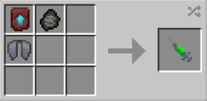

# DCEU

{ width="100" height="100" loading=lazy }

The **"Kryptonian - DCEU"** is obtained via using Kryptonian (DCEU) DNA. This can be crafted by crafting it with [Kryptonian Fossil](../../../items/artifacts/fossils/kryptonian-fossil.md), Elytra and a Smithing Template inside a crafting table.

{ width="267" height="130" loading=lazy }

**Stats**:

* Maximum Health: 42
* Maximum Healing / Second: 2 HP / 3 Seconds
* Armor Rating: 12
* Armor Toughness: 6
* Base Attack Damage: 15
* Sprint Speed: 650%
* Flight Speed: 1.45

**Main Abilities**:

* **Slot 1 (Crouch): "Combat Abilities"** - Open the ability wheel to change what active ability you have for your first slot. Selected abilities are used with non-crouch. The Abilities for the first slots are:
  * **"Strength-based Grab"** - With an empty main / offhand, use your strength to pick up an entity and hold them in front of you.
  * **"Super Knockback Punch"** - Using your strength to punch the target in front of you, knocking them back with this powerful attack. This ability scales with your strength output.
  * **"Super Strength-based Guard"** - Use your immense strength and durability to block incoming damage for a short time.
* **Slot 2 (Crouch): "Ranged Abilities"** - Open the ability wheel to change what active ability you have for your second slot. Selected abilities are used with non-crouch. The Abilities for the second slots are:
  * **"Kryptonian Frost Breath"** - Freeze the air you blow out of your mouth, pushing targets back while dealing low damage.
  * **"Kryptonian X-ray vision**" - Gain the ability to see entities within a 60 block radius. Scrolling while active can allow you to change between being able to see All, Players, Passive, Hostile entities. You will also gain the passive ability of Night Vision when you are below light level 10.
  * **"Kryptonian Heat vision"** - Fire off heated beams from your eyes to deal fire damage to your target. Second output can ignite certain blocks and fuel furnace-tyoe blocks, third output will also create fires where it hits. Output 5 will destroy block. The higher the output, the more solar energy it will cost
* **Slot 3 (Non-Crouch): "Close Combat Abilities"** - Open the ability wheel to use your abilities in your third slot. You need to hover over the abilities and click them for using it. The Abilities for the third slots are:
  * **"Kryptonian Dash Punch"** - Dash towards your target within 20 blocks of you and deliver a powerful strike.
  * **"Kryptonian Neck Breaker"** - Hold a target in front of you, then use your super strength to crack their neck with all your might and deal 50 damage.
  * **"Kryptonian Powerhouse Kick"** - Hit the target you are looking at with a powerful kick that will scale with your damage output and launch them into the sky.
  * **"Kryptonian Rage"** - Enhance your attack damage by +10 and gain the ability to attack with both your fists. While active, you will have your solar drained.

**Related Information:**

* This power **cannot use** any [Secondary Powers](../../secondary-powers/index.md).
* This power **cannot use** any [Arc Reactor](../../../items/technology/arc-reactors/index.md) higher than the [Model I Reactor](../../../items/technology/arc-reactors/model-i.md).
* This power **can breath** in space using the **Ad Astra Mod**.
* This power has the following _passives_;
  * **Fall Damage Immunity**
  * **Fire Damage Immunity**
  * **Lava Damage Immunity**
  * **Explosion Damage Immunity**
  * **Projectile Immunity**
  * **TACZ Bullet Immunity Compatibility**
* **Max Solar Energy: 800,000**
* Coming into proximity with any Kryptonite tools / blocks or items can cause the user to rapidly have their solar energy drained. All outputs (Heat vision and Freeze Breath) are reset to 1 and gain slowness. While in kryptonite poisoning you will **lose** all of your **armor, toughness and attack damage** bonus from this power. If the user is out of solar energy, and they still have the Kryptonite Poisoning effect, they will begin the lose hunger rapidly until the effect wears off.
* When on the ground and crouching, the scroll wheel can be used to increase / decrease the movement speed percentage. When in the air the scroll wheel can be used to increase / decrease the flight speed percentage.
  * When at 100% flight speed you will launch on the ground with creating an explosion around you and will destroy any blocks that will come in your way while flying. For turning of the destructive flight, you just need to fly at not 100% flight speed.
* This power can gain solar energy faster by flying up to the Y level 500.
* This power gains various stats based on the amount of Solar energy stored up. (Stats additions below are based on **full solar energy**):
  * **Attack Damage: +16**
  * **Armor Rating: +16**
* This power is _loosely_ based off of [Kal - El, a.k.a Superman from DC Extented Universe](https://dc.fandom.com/wiki/Kal-El_\(DC_Extended_Universe\)).
