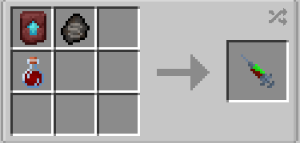

# Kryptonian (Young Justice)

{ width="100" height="100" loading=lazy }

**The "Half Kryptonian - Young Justice"** variant is obtained via using Half-Kryptonian (Young Justice) DNA. This can be crafted by crafting it with [Kryptonian Fossil](../../../items/artifacts/fossils/kryptonian-fossil.md), [Augmented Human DNA](../../../items/material/augmented-human-dna.md) and a Netherite Smithing Template inside a crafting table.

{ width=287 height=137 loading=lazy }

**Stats:**

* Maximum Health: 44
* Maximum Healing / Second: 2 HP / 3 Seconds
* Armor Rating: 14
* Armor Toughness: 6
* Base Attack Damage: 15
* Sprint Speed: 400%
* Flight Speed: N / A

**Main Abilities:**

* **Slot 1 (Non-Crouch): "Leap"** - Leap through the air with a powerful jump. This ability is only usable in the ground.
* **Slot 2 (Non-Crouch): "Thunder Clap"** - Using your strength to clap through the air, sending a shockwave out at your target. This ability deals 3 damage and applies Sound Poisoning II, Slowness II and Nausea II for 3 seconds.
* **Slot 2 (Crouch): "Overdrive Smash"** - Punch at a target directly in front of you with enough force to knock them back, This attack scales with your damage output.
* **Slot 3 (Non-Crouch): "X-ray Vision"** - Use your Kryptonian vision to see with x-ray vision. Additionally, your eyes will automatically allow you to see when its too dark.
* **Slot 4 (Non-Crouch): "Ground Smash"** - Smash the ground with your fists for a powerful and destructive attack.

**Related Information:**

* This power has the following _passives_;
  * **Night Vision (When on low level of light)**
  * **Fall Damage Immunity**
  * **Fire Damage Immunity**
  * **Lava Damage Immunity**
  * **Explosion Damage Immunity**
  * **Arrow Immunity**
  * **TACZ Bullet Immunity Compatibility**
* **Max Solar Energy: 250,000**
* Coming into proximity with any [Kryptonite](../../../blocks/ores/kryptonite.md) tools / blocks or items can cause the user to rapidly have their solar energy drained. If the user is out of solar energy, and they still have the Kryptonite Poisoning effect, they will begin to take damage until they either die, are the effect wears off.
* When on the ground and crouching, the scroll wheel can be used to increase / decrease the movement speed percentage up to 80%.
* This power gains various stats based on the amount of Solar energy stored up. (Stats additions below are based on **full solar energy**):
  * **Atack Damage**: +**4.5**
  * **Armor Rating: +3**
* This power is _loosely_ based off of [Connor Kent, a.k.a Superboy from Young Justice show.](https://dc.fandom.com/wiki/Superboy_\(Earth-16\))
