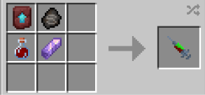

# Tactile Telekinesis

{ width="100" height="100" loading=lazy }

The **"Half Kryptonian - Tactile Telekinesis"** variant is obtained via using Half-Kryptonian (Tactile Telekinesis) DNA. This can be crafted by crafting it with [Kryptonian Fossil](../../../items/artifacts/fossils/kryptonian-fossil.md), [Augmented Human DNA](../../../items/material/augmented-human-dna.md), Amethyst Shard and a Netherite Smithing Template inside a crafting table.

{ width="282" height="132" loading=lazy }

**Stats**:

* Maximum Health: 38
* Maximum Healing / Second: 1 Heart / 3 Seconds
* Armor Rating: 12
* Armor Toughness: 4
* Base Attack Damage: 8
* Sprint Speed: 325%
* Flight Speed: 1.15

**Main Abilities**:

* **Slot 1 (Non-Crouch): "Tactile Telekinesis - Repel"** - Hit a target within a short range with a blast of your tactile telekinesis energy to deal 0.5 damage, but hit with a high knockback strength.
* **Slot 1 (Crouch): "Tactile Telekinesis - Blast"** - Launch a powerful blast of Tactile Telekinetic energy which deal 8 damage, and will bounce off walls
* **Slot 2 (Non-Crouch): "Tactile Telekinesis - Stun"** - Stun entities within a 3x3x3 radius around the user with the "Tactile Telekinesis Stun" effect for 8 seconds.
* **Slot 2 (Crouch): "Tactile Telekinesis - Area Stun"** - Stun entities within a 10x10x10 radius around the user with the "Tactile Telekinesis Stun" effect for 3 seconds, but will lock both stun abilities while on cooldown for 10 seconds.
* **Slot 3 (Non-Crouch): "Frost Breath"** - Use your Kryptonian lungs to chill the air you breathe. This ability deals damage based on the output level as follows: 1 / 2 / 4. Grants the freezing effect at output level 3. The higher the output level, the more solar energy is drained on usage.
* **Slot 3 (Crouch): "Change Frost Breath Output"** - Crouching will allow you to enabled the ability to change your Frost Breath Output. After enabling, use the scroll wheel to change the output higher or lower. Activating the ability again will lock the scroll function for your output, granting the use of the scroll wheel again.
* **Slot 4 (Non-Crouch):** **"Heat Vision"** - Shoot heated beams of energy from your eyes. This ability deals damage based on the output level as follows: 6 / 8 / 10 and can create fires. The higher the output level, the more solar energy is drained on usage.
* **Slot 4 (Crouch):** **"Change Heat Vision Output"** - Crouching will allow you to enabled the ability to change your Heat Vision Output. After enabling, use the scroll wheel to change the output higher or lower. Activating the ability again will lock the scroll function for your output, granting the use of the scroll wheel again.
* **Slot 5 (Non-Crouch): "Tactile Telekinesis - Unchained"** - Locks the usage of all of your other abilities, but in return, gain a visual change of tactile telekinetic energy emmitting from your eyes as well as significantly buffing your armor rating by +8, your knockback resistance by +5, grants knockback 2 and strength by +12 for 30 seconds. While on cooldown for 10 minutes, you will not have access to any Tactile telekinetic abilities.

**Related Information**:

* **This power can breath in space using the Ad Astra Mod.**
* This power has the following _passives_;
  * **Fall Damage Immunity**
  * **Fire Damage Immunity**
  * **Lava Damage Immunity**
  * **Explosion Damage Immunity**
  * **Arrow Immunity**
  * **TACZ Bullet Immunity Compatibility**
* Max Solar Energy: **100,000**
* Coming into proximity with any Kryptonite tools / blocks or items can cause the user to rapidly have their solar energy drained. All outputs (Heat vision and Freeze Breath) are reset to 0. If the user is out of solar energy, and they still have the Kryptonite Poisoning effect, they will begin to take damage until they either die, are the effect wears off.
  * **Kryptonite poisoning only affects the usage of Solar-based abilities, and not Tactile Telekinetic-based abilities.**
* When on the ground and crouching, the scroll wheel can be used to increase / decrease the movement speed percentage up to 90%.
* When in the air and crouching, the scroll wheel can be used to increase / decrease the flight speed percentage up to 100%.
* This power gains various stats based on the amount of Solar energy stored up, and the abilities unlocked via the Combat and Defense skill trees (stats additions below are based on **max solar energy**):
  * **Punch Damage**: +4
  * **Armor Rating**: +4
* This power is _loosely_ based off of [Kon-El, a.k.a Superboy](https://dc.fandom.com/wiki/Kon-El_\(New_Earth\)#Powers).
