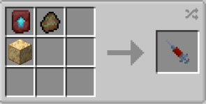

# Green Martian

{ width="100" height="100" loading=lazy }

The **"Green Martian"** power is obtained via using Czarnian DNA. This can be crafted by crafting it with [Martian Fossil](../../../items/artifacts/fossils/martian-fossil.md), Netherite Smithing Template and x1 Nth Metal Block inside a crafting table.

{ width=222 height=112 loading=lazy }

**Stats**:

* Maximum Health: 36
* Maximum Healing / Second: 2 HP / 3 Seconds
* Armor Rating: 14
* Armor Toughness: N / A
* Base Attack Damage: 14
* Sprint Speed: 110%
* Flight Speed: 0.8

**Main Abilities**:

* **Slot 1 (Crouch): "Telekinetic/Telephatic Abilities"** - Open the ability wheel to change what active ability you have for your first slot. Selected abilities are used with non-crouch. The Abilities for the first slots are:
  * **"Martian Telekinesis"** - Use your Psychic power to move blocks and entities with your mind up to 10 blocks away.
  * **"Martian Psionic Strike"** - Use your Psychic power to blast your target and deal +3 psionic damage to them over time.
  * **"Psionic Vertigo"** - Hit your target with a Psychic blast to affect their cognitive functions, slowing them down and giving them nausea.
  * **"Mental Detection"** - Use your Telepathy to uncover any / all powers your target within 20 blocks posesses.
  * **"Mindless Attack"** - Use your Telepathy to force your target to mindlessly attack anything they are looking at for 10 seconds.
  * **"Telepathic Detection"** - Using your telepathic powers, detect those around you in a 20 block range.
  * **"Telepathic Pacify"** - Using your telepathic powers, hide your presence from hostile mobs.
* **Slot 2 (Crouch): "Self Control Abilities"** - Open the ability wheel to change what active ability you have for your second slot. Selected abilities are used with non-crouch. The Abilities for the second slots are:
  * **"Martian Intangibility"** - Use your Martian abilities to phase through solid blocks. You will not be able to deal any physical damage while phasing. Flying will allow you to phase through the ground.
  * **"Martian Matter Repair"** - Use your Martian Physiology, consume your saturation to repair any armor worn.
  * **"Martian Invisibility"** - Rewrite your Martian Physiology to become invisible to those around you.
  * **"Skin Quick Change Slots"** - Save up to 5 skins to quickly turn into later without needing the command each time. Use the "/FSang.Skin Slot" command to set your skin slots, but this will not allow for the green overlay that can be toggled via the normal command. Your skin will respect the base green / not green you currently have.
  * **"Martian Size Change"** - Rewrite your Martian Physiology to become larger or smaller. Hold the button then scroll up / down to control.
* **Slot 3 (Non-Crouch): "Martian Heat Vision"** - Use your Martian abilities fire your Heat Vision from your eyes for 4 damage per hit up to 20 blocks away. This ability will not set any fires.
* **Slot 4 (Crouch): "Martian Shift Form Abilities"** - Open the ability wheel to change what active ability you have for your fourth slot. Selected abilities are used with non-crouch. The Abilities for the fourth slots are:
  * **"Martian Form Shift: Arms"** - Change your Martian Physiology to grow extra arms, which will respect any skin changes you have. While enabled, these arms will double your strength, but will also drain your saturation bar. This ability can only be used with empty main and off hands.
  * **"Martian Form Shift: Marine"** - Change your Martian Physiology to grow extra fins and gills. While enabled, these will let you breath uand swim faster underwater.
  * **"Martian Form Shift: Villager"** - Change your Martian Physiology to mimic the appearence of a Villager. In this form, you will be slower, and unable to use your main / off hands, but in return, you gain access to the Hero of the Village effect.
* **Slot 5 (Non-Crouch): "Martian True Form Reversion"** - Revert yourself to your true form locking your access to use tools, armor and all of your abilities. In return gain +20 armor rating and +6 attack damage.

**True Martian Form Reversion**

> Revert yourself to your true form locking your access to use tools, armor and all of your abilities. In return gain +20 armor rating and +6 attack damage.

* **Slot 1 (Non-Crouch, True Martian Form): "True Martian: Psychosis Attack"** - While in your True Form, release a psychic attack so power, it shakes the earth, knocks entites back, and continues to deal psychic damage to them over 15 seconds.
* **Slot 2 (Non-Crouch, True Martian Form): "True Martian: Ghost Form"** - While in your True Form, become invisible and intangible at the same time for up to 1 minute total.
* **Slot 3 (Non-Crouch, True Martian Form): "True Martian: Heat Vision"** - While in your True Form, unleash a much more powerful version of your heat vision dealing 8 damage per hit up to 30 blocks away. This ability will not set any fires.
* **Slot 4 (Non-Crouch, True Martian Form): "True Martian: Destructive Flight"** - While in your True Form, harden your skin to increase your armor rating by +4, allowing you to destructivly fly through blocks when fast flying.
* **Slot 5 (Crouch): "Disable Martian form"** - Revert your True Martian form back into your more Humanoid form, setting your abilities back to their normal functions.

**Related Information**:

* This power **cannot** use any [Secondary Powers](../../secondary-powers/index.md).
* This power **cannot** use any [Arc Reactor](../../../items/technology/arc-reactors/index.md) higher than the [Model I Reactor](../../../items/technology/arc-reactors/model-i.md).
* This power can breath in space using the Ad Astra Mod.
* If within 5 blocks of any fire / soulfire / lit campfire / lit soul campfire, you will be given slowness, and weakness until you leave the vicinity.
* This power is _loosely_ based off of [J'onn J'onzz, a.k.a Martian Manhunter](https://dc.fandom.com/wiki/J%27onn_J%27onzz_\(New_Earth\)).
