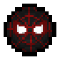
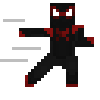

# Miles Morales

{ .pc-icon }

Main Power · Marvel · Arachnids
Arachnid – Miles Morales

Power ranking
<b class="pc-tier__rank">B</b>
B Tier

Source<b>Biological</b><small>Genetic-based power, powered by mutated D.N.A.</small>

Power classification<b class="pc-types"><i class="c-fighter">Fighter</i><i class="c-mobility">Mobility</i><i class="c-sensory">Sensory</i><i class="c-stealth">Stealth</i></b>

Obtained from<b>Arachnid Serum</b>

Ability categories<b class="pc-cats"><i class="cat-arachnid">Arachnid Abilities</i><i class="cat-stealth">Stealth</i><i class="cat-venom">Venom</i><i class="cat-bioelectricity">Bioelectricity</i></b><small>Bioelectricity runs on an energy bar that refills passively</small>

Signature look<b>Venom Bioelectricity</b><small>Blue lightning, shocks and camouflage</small>

Based on Miles Morales, aka Spider-Man. A spider-themed power built on enhanced mobility, wall-crawling and a spider sense that warns of danger. It adds the ability to turn invisible and to channel Venom bioelectricity into shocking strikes and lightning attacks.

## Stats

Maximum Health<b>38</b>

Maximum Healing / Second<b>0.3/s</b>

Armor Rating<b>7</b>

Armor Toughness<b>3</b>

Flight Speed<b>N/A</b>

Sprint Speed<b>4.3 b/s</b>

Base Attack Damage<b>9</b>

## Abilities

<a class="cat-arachnid" href="#arachnid-abilities">Arachnid Abilities</a>
<a class="cat-stealth" href="#stealth">Stealth</a>
<a class="cat-venom" href="#venom">Venom</a>
<a class="cat-bioelectricity" href="#bioelectricity">Bioelectricity</a>

### Arachnid Abilities { #arachnid-abilities }

Spider-like senses and mobility for getting around, climbing and avoiding danger.

{ .ab-icon }

#### Spider Sense

Detect any danger within 20 blocks of you. Players that deal damage to you also trigger your spider sense for up to 10 seconds after they hit you. The direction the danger is coming from is shown by the angle of the color displayed on your screen.

Range <b>20 blocks</b>Trigger on hit <b>10 seconds</b>

{ .ab-icon }

#### Arachnid Dodge

Using your enhanced mobility, dodge in the direction you are moving to avoid incoming damage.

Direction <b>Where you move</b>

{ .ab-icon }

#### Arachnid Mobility

Crouch while sprinting to slide, knocking back entities in your path. You can also double jump by pressing the jump key while in the air.

Slide <b>Crouch while sprinting</b>Double jump <b>Jump in air</b>

{ .ab-icon }

#### Arachnid Adhesion

By enhancing the inter-atomic attractive forces between your skin and a surface, you sharply increase friction to stick to and climb any surface. Wall Crawling can be toggled on and off with a key bind.

Toggle <b>Key bind</b>

{ .ab-icon }

#### Arachnid Carry

Using your enhanced strength, and with empty main and off hands, carry the target in front of you.

Requires <b>Empty hands</b>

### Stealth { #stealth }

Turn invisible to those around you.

{ .ab-icon }

#### Camouflage

Fully become invisible to those around you at will. You can stay invisible for 15 seconds, with a cooldown of 3 seconds after releasing it.

Duration <b>15 seconds</b>Cooldown <b>3 seconds</b>

{ .ab-icon }

#### Vanishing Dodge

After using the Dodge ability, become invisible for 3 seconds.

Trigger <b>After Dodge</b>Duration <b>3 seconds</b>

{ .ab-icon }

#### Fight or Flight

Turn almost completely invisible to those around you whenever your Spider Sense is going off, so long as there are no other living entities within 3 blocks of you.

Trigger <b>Spider Sense active</b>Requires <b>No entities within 3 blocks</b>

### Venom { #venom }

Guard against incoming damage and strike back with Venom energy.

{ .ab-icon }

#### Arachnid Guard

Guard up to 10 damage from the direction you are looking. Having your guard broken locks it out for 3 seconds.

Guards <b>Up to 10 damage</b>Lockout <b>3 seconds</b>

{ .ab-icon }

#### Venom Punch

Concentrate your bioelectric energy into one hand and shock any target you hit with your bare hand.

Effect <b>Shock</b>Requires <b>Bare hand</b>

{ .ab-icon }

#### Venom Leap

Using an explosion of Venom energy, leap in the direction you are looking, shocking all entities within a 3 block radius of you for 5 seconds when you do.

Radius <b>3 blocks</b>Shock <b>5 seconds</b>

{ .ab-icon }

#### Venom Smash

Smash your Venom-enabled hands into the ground, knocking all entities around you back and shocking them for 8 seconds.

Effect <b>Knockback</b>Shock <b>8 seconds</b>

### Bioelectricity { #bioelectricity }

Enhanced bioelectricity, powered by an energy bar that refills passively over time.

{ .ab-icon }

#### Chain Lightning

Launch a blast of blue bioelectricity at a target within 5 blocks of you. It then jumps to the nearest target within 10 blocks, up to 3 times total, shocking each target it hits.

Range <b>5 blocks</b>Jump range <b>10 blocks</b>Jumps <b>3 total</b>

{ .ab-icon }

#### Reverse Flux

Fire off your blue bioelectricity to all entities within a 4 block radius to pull them towards you.

Radius <b>4 blocks</b>Effect <b>Pull</b>

{ .ab-icon }

#### Bioelectric Blade

Focus your bioelectricity to form a blade of lightning in your hand. While enabled, you have the sweeping edge effect with this blade, +4 damage output, and shock applied to those hit.

Damage <b>+4</b>Effect <b>Sweeping edge · Shock</b>

{ .ab-icon }

#### Galvanized

Fire a Venom-charged attack of blue bioelectricity that launches, then holds the target in place. Any other entity that gets within 2 blocks of the galvanized target becomes shocked.

Effect <b>Holds target in place</b>Shock radius <b>2 blocks</b>

## Relevant Information

- This variant has a bioelectricity energy bar which passively refills over time.
- This power is based on Miles Gonzalo Morales, aka Spider-Man.

