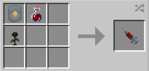

# Matter Absorption

{ width=100 height=100 loading=lazy }

The **"Matter Absorption"** is obtained via placing a vial of x1 [Augmented Human DNA](../../items/material/augmented-human-dna.md), x1 [Uru](../../blocks/ores/uru.md) Template, and x1 Wither Rose in a Smithing table.

{ width=280 height=134 loading=lazy }

**Stats**:

* Maximum Health: 28
* Maximum Healing / Second: N / A
* Armor Rating: 4
* Armor Toughness: N / A
* Base Attack Damage: 6
* Sprint Speed: 110%
* Flight Speed: N / A

**Main Abilities**:

* **Slot 1 (Non-Crouch): "Matter Absorption - Retention"** - When you have a material to absorb in your offhand, store it on yourself so free up both your hands while transformed. You must unlock the "Matter Absotption Retention" ability to use this.
* **Slot 1 (Crouch): "Matter Absorption - Retrieval"** - When you have a an empty offhand, retrieve your stored material. You must unlock the "Matter Absotption Retention" ability to use this.
* **Slot 2 (Non-Crouch): "Matter Control - Tool"** - With an empty mainhand, turn your mainhand into a pickaxe to help you mine. The level and speed will be based on the material you absorbed, as shown by the type of pickaxe that appears on your ability bar.
* **Slot 3 (Non-Crouch): "Blocking"** - Create a shield in front of you of the material you have absorbed to block incoming damage for a short time.
* **Slot 4 (Non-Crouch, No Blades): "Enable Blade Arms"** - When transformed, turn both of your arms into blades which increase your attack damage based on the material you've absorbed.
* Slot 4 (Non-Crouch, Blades): "Blade Swipe" - Swipe with both of your arms continuously to deal damage to a target in range.
* **Slot 4 (Crouch, Blades): "Disable Blade Arms"** - Revert your Blade arms back to normal.

**Related Information**:

* This power is _loosely_ based off of [Carl Kreel, a.k.a Absorbing Man](https://marvel.fandom.com/wiki/Carl_Creel_\(Earth-616\)).
* The following blocks can be absorbed with the corresponding results gained from absorbing them:

  <table>
  <tr>
  <th>Block ID</th>
  <th>Ability</th>
  </tr>
  <tr>
  <td><table>
  <tr>
  <td>minecraft:oak_log</td>
  </tr>
  <tr>
  <td>minecraft:stripped_oak_log</td>
  </tr>
  <tr>
  <td>minecraft:oak_planks</td>
  </tr>
  <tr>
  <td>minecraft:spruce_log</td>
  </tr>
  <tr>
  <td>minecraft:stripped_spruce_log</td>
  </tr>
  <tr>
  <td>minecraft:spruce_planks</td>
  </tr>
  <tr>
  <td>minecraft:birch_log</td>
  </tr>
  <tr>
  <td>minecraft:stripped_birch_log</td>
  </tr>
  <tr>
  <td>minecraft:birch_planks</td>
  </tr>
  <tr>
  <td>minecraft:jungle_log</td>
  </tr>
  <tr>
  <td>minecraft:stripped_jungle_log</td>
  </tr>
  <tr>
  <td>minecraft:jungle_planks</td>
  </tr>
  <tr>
  <td>minecraft:acacia_log</td>
  </tr>
  <tr>
  <td>minecraft:stripped_acacia_log</td>
  </tr>
  <tr>
  <td>minecraft:acacia_planks</td>
  </tr>
  <tr>
  <td>minecraft:dark_oak_log</td>
  </tr>
  <tr>
  <td>minecraft:stripped_dark_oak_log</td>
  </tr>
  <tr>
  <td>minecraft:dark_oak_planks</td>
  </tr>
  <tr>
  <td>minecraft:mangrove_log</td>
  </tr>
  <tr>
  <td>minecraft:stripped_mangrove_log</td>
  </tr>
  <tr>
  <td>minecraft:mangrove_planks</td>
  </tr>
  <tr>
  <td>minecraft:cherry_log</td>
  </tr>
  <tr>
  <td>minecraft:stripped_cherry_log</td>
  </tr>
  <tr>
  <td>minecraft:cherry_planks</td>
  </tr>
  </table>

  </td>
  <td>

  - More damage from fire
  - Increased jump height, and speed
  </td>
  </tr>
  <tr>
  <td>

  <table>
  <tr>
  <td>minecraft:grass_block</td>
  </tr>
  <tr>
  <td>minecraft:dirt</td>
  </tr>
  <tr>
  <td>minecraft:coarse_dirt</td>
  </tr>
  </table>

  </td>
  <td>

  - No Fall Damage
  </td>
  </tr>
  <tr>
  <td>

  <table>
  <tr>
  <td>minecraft:sand</td>
  </tr>
  <tr>
  <td>minecraft:red_sand</td>
  </tr>
  </table>

  </td>
  <td>

  - Knockback res
  - No movement in water
  </td>
  </tr>
  <tr>
  <td>minecraft:sponge</td>
  <td>

  - Passively absorb water in a 2x2x2 radius
  - Water breathing
  </td>
  </tr>
  <tr>
  <td>

  <table>
  <tr>
  <td>minecraft:honey_block</td>
  </tr>
  <tr>
  <td>minecraft:slime_block</td>
  </tr>
  </table>

  </td>
  <td>

  - Less player Gravity / higher leap
  - Passive Knockback punch
  </td>
  </tr>
  <tr>
  <td>minecraft:glowstone</td>
  <td>

  - Glowing / nightvision
  </td>
  </tr>
  <tr>
  <td>

  <table>
  <tr>
  <td>minecraft:stone</td>
  </tr>
  <tr>
  <td>minecraft:andesite</td>
  </tr>
  <tr>
  <td>minecraft:diorite</td>
  </tr>
  <tr>
  <td>minecraft:granite</td>
  </tr>
  <tr>
  <td>minecraft:cobblestone</td>
  </tr>
  <tr>
  <td>minecraft:mossy_cobblestone</td>
  </tr>
  <tr>
  <td>minecraft:smooth_stone</td>
  </tr>
  <tr>
  <td>minecraft:stone_bricks</td>
  </tr>
  <tr>
  <td>minecraft:mossy_stone_bricks</td>
  </tr>
  </table>

  </td>
  <td>

  - Heavier in water
  - Increased Armor toughness
  </td>
  </tr>
  <tr>
  <td>minecraft:gravel</td>
  <td>

  - Suffication immunity
  </td>
  </tr>
  <tr>
  <td>

  <table>
  <tr>
  <td>minecraft:red_sandstone</td>
  </tr>
  <tr>
  <td>minecraft:sandstone</td>
  </tr>
  </table>

  </td>
  <td>

  - Knockback res
  - Slowness in water
  </td>
  </tr>
  <tr>
  <td>minecraft:bone_block</td>
  <td>

  - Invis from mobs only
  </td>
  </tr>
  <tr>
  <td>minecraft:amethyst_block</td>
  <td>

  - Sounds effect immunity
  </td>
  </tr>
  <tr>
  <td>minecraft:magma_block</td>
  <td>

  - Passive Fire aspect
  - Fire immunity
  </td>
  </tr>
  </table>
