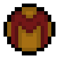

# Mimicry

{ width="100" height="100" loading=lazy }

The **"Mimicry"** is obtained via the [X-Gene](../../../items/x-gene.md) item at random chance.

**Stats**:

* Maximum Health: 33
* Maximum Healing / Second: 2 hearts / 2 Seconds
* Armor Rating: 3
* Armor Toughness: N/A
* Base Attack Damage: 3
* Sprint Speed: 110%
* Flight Speed: 0.75

**Main Abilities**:

* **Slot 1 (Non-Crouch): "Metal Form"** - Convert your body into organic metal, gaining 1+ strength and + 4 armor. This Ability also grants the Slowness 2 debuff.
* **Slot 1 (Crouch): "Electromagnetic Shield"** - Create a powerful energy shield that encompasses your body, gaining +8 armor and +6 toughness. While this is active, you cannot walk and you become unable to fly.
* **Slot 2 (Non-Crouch): "Optical Blasts** - Shoots powerful beams from your eyes dealing 7 damage.
* **Slot 2 (Crouch): "Cryokinetic Ice Blast"** - Shoot an icy ball at a target within range, dealing 6 damage and encasing your target in ice.
* **Slot 3 (Non-Crouch): "Bone Claws"** - This ability allows you to extend Bone Claws from your hands, increasing your damage by + 2.
* **Slot 3 (Crouch): "Size Down"** - Activating this will allow you to shrink down to 0.9 blocks tall, activating it again will return you to normal size.
* **Slot 4 (Non-Crouch): "Short Range Teleport"** - This allows you to teleport a short distance with a cooldown of 1 second.
* **Slot 4 (Crouch): "Create Thunderstorm"** - Activating this will create a massive thunderstorm, activating it again will clear the weather.
* **Slot 5 (Non-Crouch): "Energy Saturation"** - You can manipulate the energy inside your body to increase your saturation by 2 with a cooldown of 20 seconds.
* **Slot 5 (Crouch): "Pocket Reality - Storage"** - Access your own private storage dimension which acts like an ender chest.

**Related Information**:

* This power is _loosely_ based off of [Calvin Rankin, a.k.a Mimic](https://marvel.fandom.com/wiki/Calvin_Rankin_\(Earth-616\)).
* Currently the only way to gain extra abilities for Mimicry is via commands to gain the tags or an external addon, here is a list of all the tags that can be gained via the "/tag" command:

  | FSang.Mimic.Angel | FSang.Mimic.Apocalypse | FSang.Mimic.Colossus | FSang.Mimic.Cryokinesis | FSang.Mimic.Cyclops | FSang.Mimic.Darwin | FSang.Mimic.Detonation |
  |-------------------|------------------------|----------------------|-------------------------|---------------------|--------------------|------------------------|
  | **FSang.Mimic.Electrokinesis** | **FSang.Mimic.Eyes** | **FSang.Mimic.Face_Change** | **FSang.Mimic.Gambit** | **FSang.Mimic.Havok** | **FSang.Mimic.Healing** | **FSang.Mimic.Invisibility** |
  | **FSang.Mimic.Luck** | **FSang.Mimic.Magnetism** | **FSang.Mimic.Phasing** | **FSang.Mimic.Pyrokinesis** | **FSang.Mimic.Reality_Warping** | **FSang.Mimic.Sabretooth** | **FSang.Mimic.Size_Manipulation** |
  | **FSang.Mimic.Sonic** | **FSang.Mimic.Speed** | **FSang.Mimic.Storm** | **FSang.Mimic.Telepathy** | **FSang.Mimic.Teleportation** | **FSang.Mimic.Vulcan** | **FSang.Mimic.Wolverine** |
